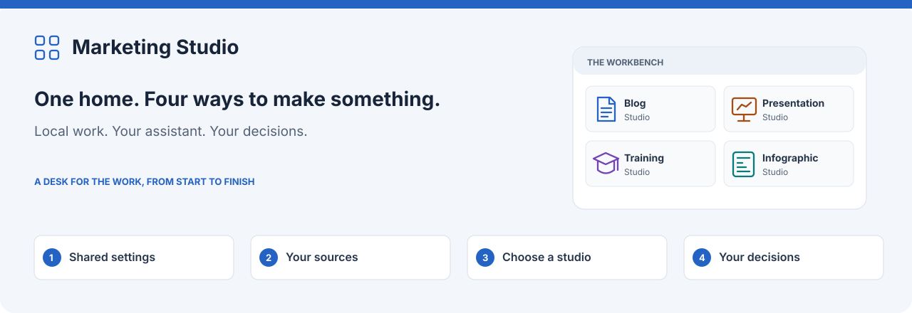

# Marketing Studio

One local home for writing blogs, making branded presentations, developing training,
and explaining ideas with infographics. Bring your material, work with your signed-in
Codex or Claude Code assistant, and refine the result on each studio’s editing desk.
You decide what is ready, what goes to Google, and what is shared.

[Get started](#get-started) · [Downloads](https://github.com/dbbaskette/marketing-studio/releases)
· [Installation](docs/installation.md) · [Shared settings](docs/shared-setup.md)

## Choose your studio

| Studio | Bring | Make and refine |
| --- | --- | --- |
| [Blog Studio](studios/blog/README.md) | A topic, outline, draft or Google Doc | Blogs, copy edits, voice-guided revisions and suggestions for the original author |
| [Presentation Studio](studios/presentation/README.md) | An idea, document or existing deck | A branded slide deck, with slide text approval before design and focused changes afterward |
| [Training Studio](studios/training/README.md) | A topic, audience and reference material | A teaching plan, learner guides, briefs, slides and practice at levels 101–401 |
| [Infographic Studio](studios/infographic/README.md) | Documents, notes, links or measured data | A visual page with editable labels and charts, optional artwork and approved exports |

Use any studio independently, or install the suite. Opening a studio starts no
assistant job. The applications run locally; assistant requests and explicitly
chosen research, Google or team operations use their respective services.

## Get started

### 1. Install

Choose an available bundle for your operating system and processor from
[Releases](https://github.com/dbbaskette/marketing-studio/releases). Unzip it and run
this inside the unpacked folder:

```sh
bash install.sh
```

Prepared platform bundles include private runtimes and the tools selected for that
bundle. Source installers may download prerequisites. **Bring Git and an installed,
signed-in Codex or Claude Code assistant**; bundled installers do not include the
assistant or sign you in. Google access, brand skills, fonts and preview tools depend
on what you make. See [requirements and platform support](docs/installation.md).

For a source installation:

```sh
git clone https://github.com/dbbaskette/marketing-studio.git
cd marketing-studio
bash install.sh
```

Install a subset with `--studios blog`, `--studios presentation`, `--studios training`
or `--studios infographic`. Select skill integration with `--target codex` or
`--target claude`. Every studio folder also has its own `install.sh` and `package.sh`.

### 2. Set up once

Run `marketing-studio` (or `~/.local/bin/marketing-studio` if it is not on your PATH).
Choose your assistant, name, work folder or team repository, and optional brand and
Google preferences. You can complete the same shared setup from any studio.

Shared settings also hold task model profiles, research sites, delivery defaults
and installation locations. Existing projects keep their saved inputs and choices;
changing defaults does not move a workspace. Setup starts no assistant work.

### 3. Start a project

- **Blog Studio:** start a new blog or choose **Edit or polish a draft**. Review
  marked changes, edit a section, or use the full desk and Finishing tools.
- **Presentation Studio:** choose an idea, document or existing deck. Where a slide
  text review is required, choose **Approve text & design deck** before design starts.
  Refine the designed slides and choose **Deliver** yourself.
- **Training Studio:** review **Here’s what this training will cover**, then choose
  **Build the training**. Edit the selected materials and mark them ready yourself.
  A requested deck has its own slide-text approval before design.
- **Infographic Studio:** choose a source-backed story, build and inspect the page,
  then approve the exact checked revision and prepare its files.

You can also ask your assistant to use a studio directly in chat. New conversation
work uses the desk’s checked records without launching another assistant. A focused
request stays focused; transferring execution to the runner is explicit.

## Sources and the Document Library

Bring files, pasted text, public links or Google Docs. The shared source panel
previews captured text and identifies extraction gaps; a picture-only PDF needs a
readable text copy. Google links use your existing gcloud sign-in. Source reads do
not change the original document. Infographic Studio also accepts CSV and Google
Slides references through its native intake.

Choose supplied material only, or explicitly enable outside research and approved
sites. [Harness Research](docs/research-synthesis.md) handles evidence gathering,
synthesis and independent checks; existing projects retain their saved contracts.

The **Document Library** on Marketing Studio’s home keeps local uploads and finished
studio material for reuse. **Add from library** captures a chosen revision for one
project, so later library changes cannot silently change it. Ready training guides
and briefs, finished blogs, delivered deck text and available PDFs, and approved
infographic text/PDF can be kept there. **Add existing work to library** previews
older finished work before you confirm it. Removing a library entry keeps copies
already used by projects. This local library is separate from team sharing.

[How the Document Library works](docs/shared-setup.md#the-document-library)

## Everyday commands

```sh
marketing-studio open blog
marketing-studio open presentation
marketing-studio open training
marketing-studio open infographic
```

| Command | Use it to |
| --- | --- |
| `marketing-studio` | Open home; keep this terminal open while working |
| `marketing-studio setup` | Complete setup or open shared settings |
| `marketing-studio start --all` | Start installed studios in the background |
| `marketing-studio start --all --lan` | Enable private phone access on trusted Wi-Fi |
| `marketing-studio restart --all` | Restart home and running studios, preserving the phone address |
| `marketing-studio restart --ts` | Restart Training Studio only |
| `marketing-studio stop --all` | Stop home and the studios |
| `marketing-studio status` | Inspect installed studios and setup |
| `marketing-studio doctor` | Check tools without contacting providers |
| `marketing-studio --help` | See commands and options |

Select individual studios with `--bs`, `--ps`, `--ts` and `--is`. Active jobs block a
normal stop or restart. For phone access, use the private link printed by the LAN
command on the same trusted network. Links grant access to your local tools; keep
them private and never expose these HTTP ports publicly. [Phone access](docs/local-network.md)

## Your work stays yours

Projects normally live under your chosen work folder:

```text
~/Studios/
├── library/
├── blog-workspace/blogs/
├── presentation-workspace/presentations/
├── training-workspace/trainings/
└── infographic-workspace/projects/
```

Blog Studio, Presentation Studio and Training Studio keep versions and decisions in
Git and can use independent clones of a shared repository. Infographic Studio keeps
local revisions and exports; its explicit team operations share selected files.
No setup action changes repository visibility or publishes a project.

Shared preferences live in `~/.config/studios-config.json`. Authentication stays
with your assistant, Git and Google. Older saved work retains its compatible flow;
eligible unfinished work offers an explicit preview before moving to the desk.
[Saved-work compatibility](docs/saved-work-compatibility.md)

## Updates, help and current limits

Use a newer unpacked release to update, preserving workspaces and settings:

```sh
marketing-studio update --from /path/to/unpacked-release --yes
marketing-studio rollback --yes
```

Check `marketing-studio doctor` when something is missing. Complete assistant sign-in
in your own terminal. Restart an updated studio when no job is active, then reload
its page. Check the [installation guide](docs/installation.md) for logs and recovery.
Opening a studio does not itself authorize installing or upgrading tools.

Infographic Studio’s editor, exports and provider adapters are implemented. Live
Codex/Gemini image acceptance, artwork review and first-release sign-off remain
separate gates. A merged feature or a fake-provider test is not proof of live
provider access. [Release readiness](docs/infographic-first-release-readiness.md)

## For contributors

Python 3.11+ standard-library application code, plain browser JavaScript, no frontend
build. Research and slide production stay in companion tools. Tests use disposable
state and synthetic inputs, never personal content or live provider jobs.

[Architecture](docs/architecture.md) · [Testing](docs/testing.md) ·
[Packaging](docs/packaging.md) · [Provenance](docs/provenance.md)

Use `bash scripts/ci/check.sh` for repository checks and
`bash scripts/ci/tart-macos.sh --dry-run` to inspect macOS runner availability.
For sibling repositories, copy `sync.cfg.sample` to ignored `sync.cfg` and run
`bash sync.sh`; see [repository sync](docs/repository-sync.md).

README illustrations are editable SVGs, not screenshots. Regenerate them with
`python3 scripts/readme_graphics.py`; [graphics notes](docs/assets/readme-graphics.md)
explain the source and checks.
