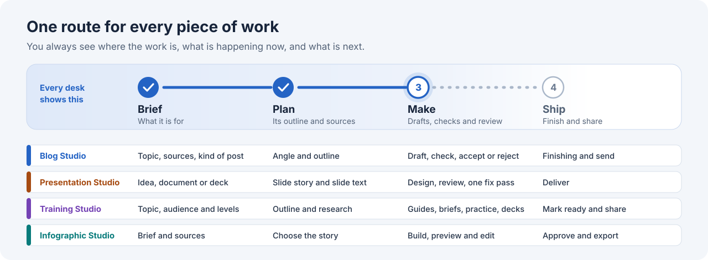

# Marketing Studio

Write the blog. Build the deck. Teach the course. Draw the idea. Marketing Studio is one
local home for all four, worked with the assistant you already use and finished on a
desk where every decision is yours.

Bring a topic, a document or a half-finished draft. Your signed-in Codex or Claude Code
assistant does the long work in the background; you read, edit and decide. Nothing goes
to Google, to your team or to anyone else until you send it.

[Get started](#get-started) · [Downloads](https://github.com/dbbaskette/marketing-studio/releases)
· [Installation](docs/installation.md) · [Shared settings](docs/shared-setup.md)
· [Keep work moving](docs/incremental-workflow.md)

## Four studios, one way of working

| Studio | Bring | Take away |
| --- | --- | --- |
| [Blog Studio](studios/blog/README.md) | A topic, outline, draft, Google Doc or a published post's link | A finished blog, copy edits marked in your text, suggestions for the original author, and a GEO review for AI search |
| [Presentation Studio](studios/presentation/README.md) | An idea, a document or an existing deck | A deck in your brand: slide text first, then design, then delivery when you choose |
| [Training Studio](studios/training/README.md) | A topic, an audience and reference material | A teaching plan, learner guides, briefs, slides and practice, at levels 101 to 401 |
| [Infographic Studio](studios/infographic/README.md) | Documents, notes, links or measured data | One clear page with editable labels and charts, optional artwork and approved exports |

Use one studio on its own or install the suite. Opening a studio starts no assistant job.



### You always know where you are

Every desk opens with the same three things, in the same place:

- **The roadmap.** Brief, Plan, Make, Ship. It is tinted as far as the work has come,
  each phase says what it is, and the line moves while your assistant is working.
- **Your move.** The one thing waiting for you, with the button that does it. When
  nothing is waiting, it says so.
- **Working now.** What the assistant is doing this moment, with **Stop**. Read or edit
  what is already there while it works.

### It checks its own work before it asks you

The studios are built to keep going. They stop for you when a decision is yours, and
not otherwise.

- **Slide text checks itself.** In Presentation Studio and Training Studio a second
  assistant job checks the slide text against your sources and corrects it once before
  you see it.
- **One pass of fixes, not a list of suggestions.** After a deck is designed it is
  reviewed, and what the review finds is fixed in a single pass, drawing and wording
  both. Whatever is left is kept as quiet review notes that hold nothing up.
- **Questions only when they are yours.** The assistant asks about your intent, a fact
  that is not in the sources, or a choice between valid options. It does not ask about
  anything it can look up or fix.
- **Approve as you go.** In Training Studio each finished draft can be marked ready
  while the next is still being written from it.
- **No clock on the long work.** In Blog Studio, Presentation Studio and Training
  Studio an assistant step runs until it finishes or you press **Stop**.

## Brand packs

Open **Brands** to create or update the packs and icon libraries the studios draw
from. A pack holds a brand's colours, fonts, logos, slide templates, layouts and its
written guide. Packs live in the repository saved under **Shared settings → Brand →
Brands repository**, and every pack found there can be chosen as your default or for
one piece of work.

Sources, extraction and review stay in a working copy until **Save** checks, seals and
commits that one brand. **Push** is a separate action that shows the exact destination
and the saved commits first. Opening the list starts no assistant and fetches no
repository. See [Brands](docs/shared-setup.md#brands).

## Document graphics

Pictures a document needs, such as an infographic's artwork, are drawn by Gemini or by
Codex. Choose which under **Shared settings**, **Document graphics**. Gemini needs an API
key: paste it there once, list the picture models your key can use, and pick one. The key
stays in a private file on your computer and is never shared with your team.

## Get started

### 1. Install

Choose a bundle for your operating system and processor from
[Releases](https://github.com/dbbaskette/marketing-studio/releases). Unzip it and run
this inside the unpacked folder:

```sh
bash install.sh
```

Prepared bundles include private runtimes and the tools selected for that bundle.
Source installers may download prerequisites. **Bring Git and an installed, signed-in
Codex or Claude Code assistant**; the installers do not include the assistant or sign
you in. Google access, brand skills, fonts and preview tools depend on what you make.
See [requirements and platform support](docs/installation.md).

For a source installation:

```sh
git clone https://github.com/dbbaskette/marketing-studio.git
cd marketing-studio
bash install.sh
```

Install a subset with `--studios blog`, `--studios presentation`, `--studios training`
or `--studios infographic`. Select skill integration with `--target codex` or
`--target claude`. Every studio folder also has its own `install.sh` and `package.sh`.

### 2. Set up once

Run `marketing-studio` (or `~/.local/bin/marketing-studio` if it is not on your PATH).
Choose your assistant, name, work folder or team repository, and optional brand and
Google preferences. The same shared setup can be completed from any studio, and it
starts no assistant work.

Shared settings also hold task model profiles, research sites, delivery defaults and
installation locations. Existing projects keep their saved inputs and choices; changing
a default never moves a workspace. Under **Assistant → Quick scan speed** you can pick
a lighter first pass after seeing the model and reasoning it would use.
[Quick scan settings](docs/shared-setup.md#quick-scan-speed)

### 3. Make something

- **Blog Studio.** Start a new blog, or choose **Edit or polish a draft**. **Your move**
  starts the check; each fix is marked in your text to accept or reject. Finishing
  holds the claim check, the GEO review and the send to Google. For a post that is
  already live, choose **Get a GEO report for a published post**.
- **Presentation Studio.** Start from an idea, a document or an existing deck. Read
  the checked slide text and choose **Approve text & design deck**. The designed deck
  is reviewed and fixed once by itself; refine what you like and choose **Deliver**.
- **Training Studio.** Edit the proposed outline, then choose **Approve outline &
  research**. Guides and briefs come first, then practice, then decks. Read each draft
  as it arrives and mark it ready. Slide text approval before design is on by default
  and can be turned off when you start. See the
  [training flow and task map](docs/design/create-training-task-flow.md).
- **Infographic Studio.** Choose a source-backed story and build the page; the preview
  is drawn as soon as it is built. Inspect it, approve the exact checked revision and
  prepare its files.

You can also ask your assistant to use a studio directly in chat. A focused request
stays focused, and handing the work to a studio's runner is always explicit.

Home lists **Unfinished drafts**, work that **Needs you**, work **In progress** and
**Recent work**. Resume a private form, start fresh, or discard it without deleting a
project. [Keep work moving](docs/incremental-workflow.md) covers recovering edits made
in two tabs, reading research while it is still being checked, and how flagged claims
are handled.

### On your phone

Start with `marketing-studio start --all --lan` and open the private link it prints, on
the same trusted Wi-Fi. Pages are compressed and reused between visits, so they open
quickly over a slow link. The link grants access to your local tools: keep it private
and never expose these ports publicly. [Phone access](docs/local-network.md)

## Sources and the Document Library

Bring files, pasted text, public links or Google Docs. The shared source panel
previews captured text and identifies extraction gaps; a picture-only PDF needs a
readable text copy. Google links use your existing gcloud sign-in. Source reads do
not change the original document. Infographic Studio also accepts CSV and Google
Slides references through its native intake.

Choose supplied material only, or explicitly enable outside research and approved
sites. [Harness Research](docs/research-synthesis.md) handles evidence gathering,
synthesis and independent checks; existing projects retain their saved contracts.

The **Document Library** on Marketing Studio’s home keeps local uploads and finished
studio material for reuse. **Add from library** captures a chosen revision for one
project, so later library changes cannot silently change it. Ready training guides
and briefs, finished blogs, delivered deck text and available PDFs, and approved
infographic text/PDF can be kept there. **Add existing work to library** previews
older finished work before you confirm it. Removing a library entry keeps copies
already used by projects. This local library is separate from team sharing.

[How the Document Library works](docs/shared-setup.md#the-document-library)

## Everyday commands

```sh
marketing-studio open blog
marketing-studio open presentation
marketing-studio open training
marketing-studio open infographic
```

| Command | Use it to |
| --- | --- |
| `marketing-studio` | Open home; keep this terminal open while working |
| `marketing-studio setup` | Complete setup or open shared settings |
| `marketing-studio start --all` | Start installed studios in the background |
| `marketing-studio start --all --lan` | Enable private phone access on trusted Wi-Fi |
| `marketing-studio open --no-open` | Show links for the running home in your terminal |
| `marketing-studio open --lan` | Open its existing phone-access link |
| `marketing-studio restart --all` | Restart home and running studios, preserving the phone address |
| `marketing-studio restart --ts` | Restart Training Studio only |
| `marketing-studio stop --all` | Stop home and the studios |
| `marketing-studio status` | Inspect installed studios and setup |
| `marketing-studio doctor` | Check tools without contacting providers |
| `marketing-studio --help` | See commands and options |

Select individual studios with `--bs`, `--ps`, `--ts` and `--is`. Active jobs block a
normal stop or restart.

## Your work stays yours

Projects normally live under your chosen work folder:

```text
~/Studios/
├── library/
├── blog-workspace/blogs/
├── presentation-workspace/presentations/
├── training-workspace/trainings/
└── infographic-workspace/projects/
```

Blog Studio, Presentation Studio and Training Studio keep versions and decisions in
Git and can use independent clones of a shared repository. Infographic Studio keeps
local revisions and exports; its explicit team operations share selected files.
No setup action changes repository visibility or publishes a project.

Shared preferences live in `~/.config/studios-config.json`. Authentication stays
with your assistant, Git and Google. Older saved work retains its compatible flow;
eligible unfinished work offers an explicit preview before moving to the desk.
[Saved-work compatibility](docs/saved-work-compatibility.md)

## Updates, help and current limits

Use a newer unpacked release to update, preserving workspaces and settings:

```sh
marketing-studio update --from /path/to/unpacked-release --yes
marketing-studio rollback --yes
```

Check `marketing-studio doctor` when something is missing. Complete assistant sign-in
in your own terminal. Restart an updated studio when no job is active, then reload
its page. Check the [installation guide](docs/installation.md) for logs and recovery.
Opening a studio does not itself authorize installing or upgrading tools.

Infographic Studio’s editor, exports and provider adapters are implemented. Live
Codex/Gemini image acceptance, artwork review and first-release sign-off remain
separate gates. A merged feature or a fake-provider test is not proof of live
provider access. [Release readiness](docs/infographic-first-release-readiness.md)

## For contributors

Python 3.11+ standard-library application code, plain browser JavaScript, no frontend
build. Research and slide production stay in companion tools. Tests use disposable
state and synthetic inputs, never personal content or live provider jobs.

[Architecture](docs/architecture.md) · [Testing](docs/testing.md) ·
[Packaging](docs/packaging.md) · [Provenance](docs/provenance.md) ·
[UI visibility review](docs/design/2026-11-06-visibility-review.md) ·
[Golden Gate 2.1 UX and performance audit](docs/design/2026-11-06-golden-gate-21-audit.md) ·
[Cult UI controls and source attribution](docs/design/cult-controls.md)

Use `bash scripts/ci/check.sh` for repository checks and
`bash scripts/ci/tart-macos.sh --dry-run` to inspect macOS runner availability.
For sibling repositories, copy `sync.cfg.sample` to ignored `sync.cfg` and run
`bash sync.sh`; see [repository sync](docs/repository-sync.md).

README illustrations are editable SVGs, not screenshots. Regenerate them with
`python3 scripts/readme_graphics.py`; [graphics notes](docs/assets/readme-graphics.md)
explain the source and checks.
