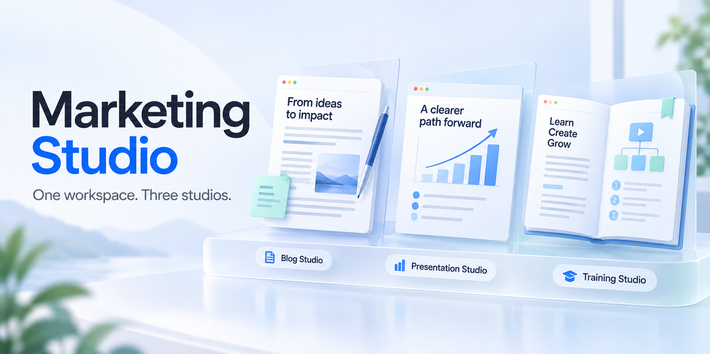

# Marketing Studio

A local workbench for technical and product marketing: write or polish a blog,
build a presentation, develop training, or explain an idea with an infographic.
Bring the material you have. Let your chosen assistant do the research and
production work, then review the decisions that matter.

Marketing Studio brings four independently runnable studios together with shared
settings, source intake and launching. Your projects stay on your computer.
Assistant jobs use your signed-in Codex or Claude Code; linked documents and
optional external research use the services you choose.

[Download an installer](https://github.com/dbbaskette/marketing-studio/releases/latest)
· [Installation guide](docs/installation.md)
· [Shared settings](docs/shared-setup.md)
· [Architecture](docs/architecture.md)

## Choose the job

| Studio | Start with | Work toward |
| --- | --- | --- |
| **[Blog Studio](studios/blog)** | A topic, an outline, pasted/uploaded writing, or a Google Doc | A new blog or a polished existing draft. Edit locally, proofread/copy edit/humanize, check facts when needed, and prepare suggestions or comments for the author. |
| **[Presentation Studio](studios/presentation)** | An idea, reference material or an existing deck | An editable branded deck. Review slide titles, visible text, order and speaker notes before approving design. |
| **[Training Studio](studios/training)** | A topic, audience, desired depth and reference material | A teaching plan, learner guide, reference brief, deck and practice, at the levels you select. Review the proposed topics once, request changes, then build the selected materials. Optional Yoodli preparation includes its required brief and practice scenarios. |
| **[Infographic Studio](studios/infographic)** | Supplied documents, notes, links or data | A visual page with diagrams, charts, concise labels and optional artwork. Choose a story, refine the page and approve its exports. |

You can use one studio on its own. Installing or opening Marketing Studio does not
require you to use all four, and opening a studio does not start an assistant job.

Infographic Studio is implemented in the source tree, including visual pages,
file/Google reference intake and local exports. Live image-provider and owner
visual acceptance remain release gates; a code merge is not a published release.
See [release readiness](docs/infographic-first-release-readiness.md) and the
[acceptance checklist](studios/infographic/docs/acceptance.md) for the current limits.

## Bring your sources

The studios share a research source panel. Add web URLs, Google Doc links,
uploaded PDF/Word/text/Markdown/HTML files, or pasted text. Inspect captured text,
choose Google Doc tabs and resolve unreadable sources before starting research.
Infographic Studio also accepts CSV data through its native intake.

**External search is a choice.** Use only the material you supplied, or allow
additional public research and optionally restrict it to approved sites. Google
links use your existing sign-in and shared account defaults. Source capture does
not write to the original document.

PDFs need readable text and an installed `pdftotext` reader (provided by Poppler).
A scan may contain only pictures; encrypted or damaged files may be unreadable.
The studios explain extraction gaps rather than inventing missing text or silently
sending the file to an OCR service. See [document tools](docs/installation.md#optional-capabilities).

**Keep a document once, use it anywhere.** The shared Document Library holds
uploads you add on Marketing Studio's **Library** screen, finished blogs and
delivered decks. It lives in `library/` under your work folder (normally
`~/Studios/library`) and stays on this computer. In Presentation Studio and Blog
Studio, **Add from library** copies chosen revisions into that one deck or blog,
which keeps them even if the library changes. Choosing a document starts nothing:
no research, no web access and no assistant job. See
[the Document Library](docs/shared-setup.md#the-document-library).

Research uses the shared Harness Research workflow: up to three investigators,
followed by synthesis and an independent check. Progress and checked evidence are
saved so recovery can reuse completed work. Existing saved projects retain the
workflow and tool contract they started with. See [research and compatibility](docs/research-synthesis.md).

## Get started

### Install

Download a bundle for your operating system and processor from
[Releases](https://github.com/dbbaskette/marketing-studio/releases/latest), unzip
it, and run this from the unpacked folder:

```sh
bash install.sh
```

Platform bundles include private Python/Node runtimes and the selected studios'
dependencies. Smaller source installers fetch their prerequisites during setup.
Bring Git and a signed-in Codex or Claude Code assistant. Google access, brand
skills and PDF/slide-preview tools depend on the work you choose.

To install from source instead:

```sh
git clone https://github.com/dbbaskette/marketing-studio.git
cd marketing-studio
bash install.sh
```

Choose a subset with `--studios blog`, `--studios presentation`,
`--studios training` or `--studios infographic`. Use `--target codex` or
`--target claude` to select an assistant. Existing work and settings stay in place.
The [installation guide](docs/installation.md) covers offline options, platforms,
optional tools and unattended setup; [packaging](docs/packaging.md) covers building
suite or individual-studio downloads.

### Set up once

Run `marketing-studio` or open **Open Marketing Studio.command**. The command is
installed in `~/.local/bin`; use `~/.local/bin/marketing-studio` if your shell has
not added that directory to `PATH`.

Choose your name and assistant, a local work folder or shared repository, and
optional brand/delivery settings. Setup prepares workspaces without starting an
assistant job. You can complete the same setup in any individual studio; the other
studios reuse it, including studios installed later.

Shared choices include assistant/model/reasoning settings, Quick/Main/Complex task
profiles, Google account, brand source, delivery, research sites and sharing
preferences. Existing projects retain saved choices. Changes to shared settings
never move an existing workspace automatically.

### Make something

Open a studio and describe the result you want. Add the references it should use.
The assistant handles the intervening work and shows progress, saved results and
any decision it needs from you.

- **Blog Studio:** polish a document directly, or develop a new blog. Research is
  optional for proofreading and copy editing. Keep edits local until you choose
  a Google update, suggestions/comments or another delivery action.
- **Presentation Studio:** ask for changes to the slide text or choose
  **Approve text & design deck**. Then refine the designed slides.
- **Training Studio:** review **Here’s what this training will cover**, ask for
  changes, or choose **Build the training**. It creates your selected materials
  without a sample lesson or a second default slide-text checkpoint.
- **Infographic Studio:** review the captured information and story choices,
  refine the visual page, and explicitly approve the version you want to export.

Approving a plan is separate from marking finished materials ready or publishing.
Real missing inputs, limits and requested design walkthroughs can still need you.

## Everyday commands

```sh
marketing-studio open blog
marketing-studio open presentation
marketing-studio open training
marketing-studio open infographic
```

| Command | Purpose |
| --- | --- |
| `marketing-studio` | Open the home page; keep this terminal open while working |
| `marketing-studio start --all` | Run in the background with all installed studios |
| `marketing-studio start --all --lan` | Also enable private phone access on trusted Wi-Fi |
| `marketing-studio restart --all` | Restart the running studios and home server, preserving phone access and port |
| `marketing-studio restart --ts` | Restart Training Studio only |
| `marketing-studio stop --all` | Stop the studios and home server |
| `marketing-studio setup` | Open shared settings or initial setup |
| `marketing-studio status` | Show installed studios, locations and setup status |
| `marketing-studio doctor` | Check local prerequisites without contacting providers |
| `marketing-studio --help` | Show all commands and options |

Select studios with `--bs`, `--ps`, `--ts` and `--is`. An active assistant job blocks
a normal stop/restart so its work is not interrupted. Starting a session prints
private browser links; `--json` output omits keys. See [lifecycle commands](docs/installation.md)
and [phone access](docs/local-network.md).

For phone use, keep the phone and computer on the same trusted network and open
the private phone link printed by `start --all --lan`. Launch the studio there.
Your work and signed-in tools stay on the computer. Private links grant access to
those tools; do not expose the HTTP ports to the public internet.

## Local work and optional team sharing

By default, projects live under your chosen work folder:

```text
~/Studios/
├── blog-workspace/blogs/
├── presentation-workspace/presentations/
├── training-workspace/trainings/
└── infographic-workspace/projects/
```

Blog Studio, Presentation Studio and Training Studio keep decisions and versions
in local Git. They can each join an existing shared repository using their own
clone and content folder. Sharing can happen after decisions or only when asked.
Infographic Studio keeps local revisions and exports; its Team library can share
selected files through a configured repository.

A changed shared repository setting preserves existing workspaces. Use a studio's
explicit Connect/Join action to move into the configured team workflow. Setup does
not change repository visibility or publish your project. Infographic exports,
Google delivery and publishing each have their own explicit actions.

Shared preferences live in `~/.config/studios-config.json`. Authentication stays
with your assistant, Git and Google, outside that preferences file.

## Update or troubleshoot

Download and unpack a newer release, then use the folder containing `installer/`:

```sh
marketing-studio update --from /path/to/unpacked-release --yes
marketing-studio rollback --yes
```

Opening a studio never installs or updates tools automatically. Companion versions
are checksum-locked in [`pins/companions.json`](pins/companions.json). Compatible
installed copies are reused (`>=1.0.0` for Harness Research and
`>=0.16.0` for Harness Slides). Your brand skill is configured separately.

If an assistant cannot start, complete its sign-in in your own terminal. If a tool
is missing, use `marketing-studio doctor` and the installation guide. If a studio
shows older controls after an update, restart it when no assistant job is active
and reload the page. The launch error names its log file when a studio cannot open.

## For contributors

Python 3.11+, standard-library application code, browser JavaScript and no frontend
build step. Research and slide engines remain separate companion tools.

```text
marketing_studio/    Home page, shared setup and launcher CLI
studios/            Four independently runnable studio pipelines and tests
core/studio_core/    Shared settings, sources, research and runner infrastructure
ui-kit/             Shared browser components and Golden Gate-inspired styling
installer/          Suite/subset installation and platform packaging
pins/               Verified companion versions
```

Start with the [architecture](docs/architecture.md), [testing guide](docs/testing.md),
[packaging guide](docs/packaging.md), [saved-work compatibility](docs/saved-work-compatibility.md)
and [source provenance](docs/provenance.md). Tests use disposable workspaces and
synthetic material, never personal projects or live provider jobs.

```sh
bash scripts/ci/check.sh
bash scripts/ci/tart-macos.sh --dry-run
```

For related source checkouts, copy `sync.cfg.sample` to ignored `sync.cfg` and run
`bash sync.sh`; [repository sync](docs/repository-sync.md) describes the options.
