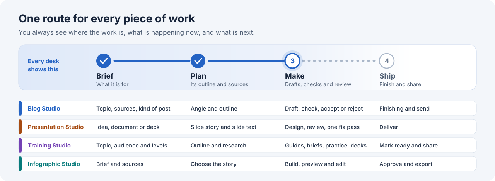

# Marketing Studio

Bring your material, choose what you want to make, and work with your signed-in Codex or Claude Code assistant on a local editing desk. You can install the whole suite or just the studio you need.


## Choose a studio

| I want to… | Start here | Bring along |
| --- | --- | --- |
| Write a post in my voice or get edits on a draft | [Blog Studio](studios/blog/README.md) | A point you want to make, rough notes or a draft |
| Present an idea or refresh an existing deck | [Presentation Studio](studios/presentation/README.md) | The audience, a brief or slides, and your brand |
| Teach someone to do a task | [Training Studio](studios/training/README.md) | The learner’s starting point, their goal and reference documents |
| Explain a process or comparison on one page | [Infographic Studio](studios/infographic/README.md) | Source text or measurements and the point readers should remember |

## Get started

1. **Choose a download.** Get the suite or a single studio for your computer. Have Git and a signed-in Codex or Claude Code assistant available. [Downloads](https://github.com/dbbaskette/marketing-studio/releases) · [Platforms and requirements](docs/installation.md)
2. **Install.** Unzip the download, open a terminal in the unpacked folder, and run the installer.

   ```sh
   bash install.sh
   ```

3. **Open your desk.** For the suite, run the command below and keep the terminal open. On first launch, pick your assistant and a folder where you want your work saved. If you installed one studio independently, its README gives its own launch command.

   ```sh
   marketing-studio
   ```

4. **Start a project.** Choose a studio from Home. Its README walks you through a first project, including what to bring, when to review, and how to get the finished file.

<details>
<summary>Install from a source checkout</summary>

```sh
git clone https://github.com/dbbaskette/marketing-studio.git
cd marketing-studio
bash install.sh
```

To install one studio, add `--studios blog`, `--studios presentation`, `--studios training` or `--studios infographic` to the install command. Source installs may download prerequisites. [Installer options](docs/installation.md#source-installers)

</details>

## Find your way back to work

Home lists unfinished drafts and projects waiting for you. On a desk, **Your move** shows the decision you can make next. **Working now** shows what your assistant is doing. Use the **Document Library** on Home to reuse a source across projects. Choosing a library document copies that revision into the project. [Document Library](docs/shared-setup.md#the-document-library)

<details>
<summary>See how the four studios move from brief to finished work</summary>



</details>

| When you need to… | Where to go |
| --- | --- |
| Open one studio directly | Run `marketing-studio open` followed by `blog`, `presentation`, `training` or `infographic` |
| Set a default brand, assistant or graphics provider | Open **Shared settings**. [Setup and brands](docs/shared-setup.md) |
| Check why a tool is unavailable | Run `marketing-studio doctor`. [Installation and recovery](docs/installation.md) |
| Resume an older project or work from a phone | [Saved work](docs/saved-work-compatibility.md) · [Private phone access](docs/local-network.md) |
| Build or contribute | [Architecture](docs/architecture.md) · [Testing](docs/testing.md) · [Packaging](docs/packaging.md) |
