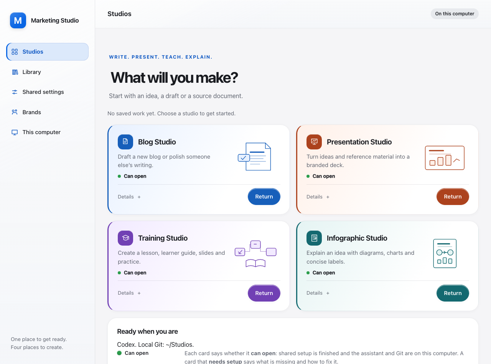
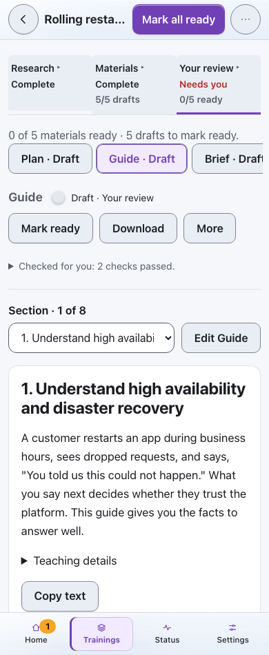

# Golden Gate 2.1 UX and performance audit — November 6, 2026

This round followed the updated `macos-golden-gate-design` 2.1.0 skill after it
became available. It reviewed Marketing Studio, shared settings, the four native
studios and their research, slide and brand guidance. Each new finding became a
component-tagged issue, implemented and merged before the next issue began.
The [earlier visibility review](2026-11-06-visibility-review.md) covers slide
scrolling, button contrast, task tabs, settings sections, spelling and brands.

## Findings and shipped changes

| Component / finding | Result | Issue → merged PR |
| --- | --- | --- |
| Training Studio loaded every material editor on a full refresh. | Load the selected editor, open others on demand, reuse unchanged revisions and keep local edits. Loading/retry feedback, late-response guards and Finishing still cover unvisited materials. | [#412](https://github.com/dbbaskette/marketing-studio/issues/412) → [#416](https://github.com/dbbaskette/marketing-studio/pull/416) |
| Blog Studio polled hidden tabs and presented filtered empty lists as empty collections. | Skip hidden run reads; refresh on return. No-match recovery clears actual search, filters and pagination and returns focus to Search. Genuine empty collections retain onboarding. | [#413](https://github.com/dbbaskette/marketing-studio/issues/413) → [#417](https://github.com/dbbaskette/marketing-studio/pull/417) |
| The launchpad lacked visual emphasis and repeated healthy status explanations. | Stronger creative heading, distinct opaque studio cards, filled actions and an accent edge on selection. Healthy Details and completed Recent work are disclosures; recovery stays visible. | [#414](https://github.com/dbbaskette/marketing-studio/issues/414) → [#418](https://github.com/dbbaskette/marketing-studio/pull/418) |
| Training Studio repeated controls and long section tabs delayed reaching the document. | Compact material header, optional successful-check detail and one labeled section picker for long documents. Editing and selection retain focus and local text; phone commands reflow at the breakpoint. | [#415](https://github.com/dbbaskette/marketing-studio/issues/415) → [#419](https://github.com/dbbaskette/marketing-studio/pull/419) |
| Harness Slides required another weakest-slide repair and preview after a clean inspection. | Repair observed defects within two total worker repair rounds. Return a clean unchanged inspected preview with its valid receipt. Changed-image inspection, final deck review and user approval remain required. | [Harness Slides #81](https://github.com/dbbaskette/harness-slides-skill/issues/81) → [#82](https://github.com/dbbaskette/harness-slides-skill/pull/82) |

## Measured differences

All measurements use disposable native pages and synthetic content; no live
provider jobs or personal training state were used.

| Check | Before | After |
| --- | ---: | ---: |
| Five-material Training Studio full refresh: editor requests | 5 | 1 |
| Same fixture: editor response bytes | 89,495 | 15,904 |
| Same fixture: median loopback full-refresh time, five samples | 245 ms | 113 ms |
| Eight-section guide: reading paper position at 1280px width | 793px | 548px |
| Same guide at 390px width, matching responsive toolbar | 641px | 530px |
| Blog Studio run reads across five hidden poll ticks | One scheduled read per tick | 0; one catch-up read on return |

The refresh fixture removes 80% of editor requests, 82% of editor response bytes
and 54% of measured refresh wall time. The guide begins 245px earlier on desktop
and 111px earlier on phone. These do not establish model-generation speedups.
The Harness Slides change removes a mandatory extra pass; its provider wall-time
effect was not benchmarked.

## Coverage and retained behavior

Marketing Studio home and settings were checked across desktop/phone, light/dark,
keyboard navigation, reduced effects and enlarged text. Launch actions and selected
navigation meet 4.5:1 label contrast. Setup failures, unavailable work and reconnecting
states remain actionable. Shared material is reserved for navigation and transient
controls; forms and reading surfaces remain opaque.

Training Studio checks cover lazy editors, retry, late responses, unsaved edits,
slide selection and caret, long-document navigation, Finishing, Yoodli fields,
downloads and sheet focus. Blog Studio covers filtered views, clear/recovery,
pagination and hidden/visible reads. Presentation Studio's existing single-slide
desk and Infographic Studio's intake, story and preview tasks retain their task
structure and receive the shared selection treatment. No provider, spending,
source-permission, save or approval contract changed.

The related skill review retained progressive stage guidance: outline, design,
composition and review inputs already load for their respective workers. Harness
Slides' unconditional polish instruction was the concrete guidance defect fixed
here. The existing four-brand Harness Brand setup remains documented in the
[shared setup guide](../shared-setup.md#harness-brand-and-the-four-brands).

## Verification

- Blog Studio: complete 1,878-test offline suite in disposable Tart, plus lint,
  format, package/guidance and client checks; native browsing journey at 390/1280px.
- Training Studio: 484 affected tests for lazy loading; the later full suite ran
  3,227 tests in Tart. Two listener-adapter failures and one stale US English test
  expectation were corrected; all 107 tests in the affected classes then passed,
  with package validation and the final native reading journey. The other 3,120
  full-suite tests passed unchanged. The stale assertion also failed on the base.
- Shared UI: 47 layout/consistency tests; 125 affected launchpad tests; the focused
  Tart home/recovery run included 58 shared checks and 40 Infographic Studio checks.
  Browser journeys covered widths from 320 to 1920px, light/dark, keyboard, 44px
  controls, reduced effects, 200% equivalent viewport and no horizontal overflow.
- Harness Slides: routed guidance/context tests, regenerated context counts and
  Markdown links in a clean tracked-tree copy; required Node 20/22 core and native
  GitHub CI checks passed. No runtime or review gate was removed.

Tart runs used macOS 27.0, Python 3.13.15 and Node 22.23.2, and deleted their
disposable VMs. Unchanged successful evidence was reused after focused corrections.
The implementation plans preserve scope, state matrices and exact test details:
[selected editors](../superpowers/plans/2026-11-06-selected-training-editor.md),
[Blog Studio browsing](../superpowers/plans/2026-11-06-blog-browsing-feedback.md),
[launchpad](../superpowers/plans/2026-11-06-golden-gate-21-launchpad.md), and
[reading flow](../superpowers/plans/2026-11-06-training-reading-flow.md).

## Existing work still tracked

Parallel independent research checks with durable receipts remain
[#378](https://github.com/dbbaskette/marketing-studio/issues/378); per-unit progress
and final assembly/check visibility remain
[#379](https://github.com/dbbaskette/marketing-studio/issues/379). These need the
research protocol and host adapters to change together and are not claimed as
completed by this UI pass. Infographic Studio's live provider and owner acceptance
gate remains [#224](https://github.com/dbbaskette/marketing-studio/issues/224).

## Screenshots

Synthetic empty-work launchpad, with all four studios available:

Training Studio's compact material controls and long-document section picker:

