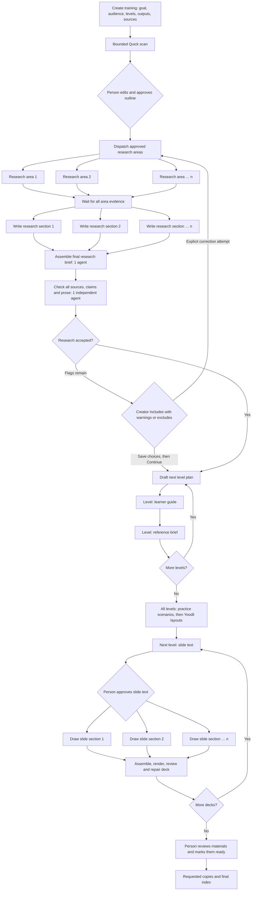
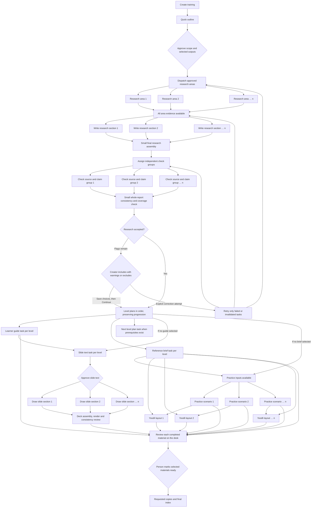

# Create training: flow and task boundaries

Updated 2026-11-06 for creator decisions (#385), readable-first ordering (#387),
truthful progress (#388), and the Golden Gate v2 UI audit (#391).
The parallel scheduler and overall progress map (#392) below remain proposals.
This describes new outline-first Training Studio desk runs; saved older runs keep
their recorded workflow. Optional outputs are omitted when not selected.

Boxes labeled **1, 2, … n** are separate tasks eligible to run concurrently;
`n` is the number of units in that group, not the number of simultaneous agents.
Forks show independent work and joins show required completion boundaries.
Research currently allows up to three active agents; the proposed graph uses one
shared three-agent allowance across eligible work.

## Current flow

This is the scheduling order, not a claim that every arrow is a necessary content
dependency. The desk carries intermediate gate receipts; those receipts are not
the person's final approval. A selected/default brand look can avoid a separate
look decision. Deck preview capture is serialized even when section drawing is
parallel. Requested copies can be produced earlier when the relevant material is
ready or explicitly sent; the final index waits for all materials to be ready.

New outline-first runs pin this readable-first order. Each level's guide and brief
can arrive before later level planning, and selected practice precedes the first
slide approval. Higher-level plans still receive earlier objectives. This is a
priority change, not a concurrent material scheduler. Saved runs without that pin
keep their original sequence; explicit updates retain their scoped ordering/holds.

The research coordinator has phase barriers: section writing currently waits for
all investigators, and independent checking waits for the assembled dossier.
Completed research areas and section contributions survive unrelated failures.
The final research brief now has a narrow assembly role and uses the saved
combining allowance (issue #377, merged in PR #380).
Training Studio stops after one independent check per explicit attempt. Remaining
flags become creator choices, with the original independent verdict retained.
Exclusions also omit dependent content. An explicit retry can request one correction
and another check; ordinary viewing or saving decisions starts no provider work.
Final-author objections survive revisions to other sections.

## Recommended task graph

Keep small coordination jobs ordered. Use one shared queue, initially capped at
three active agents, for independently writable units. A task starts as soon as
its actual inputs and required approvals are available. This cap is a proposal
for the expanded scheduler, not a claim that the current separate pools share one.

The diagram's correction arrows are conditional: an evidence failure returns to
research; a prose failure returns to its section; a transient checker failure
retries its check. They do not restart every branch. The first implementation
should retain the research phase barriers. Starting section writing before all
evidence arrives is a later optimization requiring stable evidence revisions.

## Task contracts and useful splits

| Task | Required inputs | Output and parallel boundary | Recommendation |
| --- | --- | --- | --- |
| Quick scan | Intake and bounded supplied excerpts | One editable provisional outline | Keep one short task; no deep research here. |
| Investigate an area | Approved area's questions and permitted sources | Captures, cited facts, explicit gaps | Already parallel, up to three. Split unusually broad scope during outline review. |
| Write a research section | Registered area evidence and approved outline | Finding IDs and section prose | Already parallel. Preserve successful contributions. |
| Assemble research brief | Completed contributions | Brief, introduction and permitted comparisons | Keep one small coordination task; no section rewrite or new investigation. |
| Check evidence and claims | Exact dossier revision, assigned originals and full claim dependencies | Independent review receipts for assigned IDs | Highest-priority new split: bounded source-local groups; avoid making each checker reread the whole library. |
| Check global research coherence | Complete receipts and assembled research | Coverage, usefulness, contradictions and unresolved gaps | One independent final assessment; cannot invent missing source-read receipts. |
| Draft a level plan | Accepted research, intake and earlier levels' objectives | Objectives, modules, key points and practice plan | Preserve ordered progression initially. Once a plan exists, its materials need not wait for every later plan. |
| Write learner guide | Its level plan, accepted research and earlier objectives | One level's guide | Parallel with that level's reference brief and independent work in other levels. |
| Write reference brief | Its level plan and accepted research | One level's reference brief | Does not need the learner guide. Can unlock practice while slides proceed. |
| Write slide text | Level plan, research, and selected learner guide | Slide outline for human approval | Separate from drawing; do not silently drop the selected guide dependency. |
| Draft practice scenario | Level practice plan and selected reference brief | One scenario | Run scenarios independently, without waiting for the deck. |
| Lay out Yoodli scenario | Its scenario, objectives, profile and brief | One Yoodli layout | Start after its own scenario, without waiting for all scenarios. Bind available upload-copy metadata honestly. |
| Draw slide section | Approved slide text, design, brand and assets | One section contribution | Already parallel. Preserve ordered assembly and renderer ownership. |
| Review and deliver | Exact saved material revisions and person decisions | Ready materials, requested copies and index | Material review can proceed as drafts arrive; final delivery requires complete selected outputs and approvals. |

Do not initially create an agent for every paragraph, slide, citation or local
edit. Task startup, context copying and repeated source reading can erase the
gain from smaller units. Split by a meaningful artifact or bounded evidence set,
then measure whether unusually large units need another subdivision.

## Decisions recommended for implementation

1. **Finish parallel research checking first** (#378), with progress labels (#379).
   Keep semantic checks and independent authorship. This requires a versioned
   Harness Research team-review contract, not several agents impersonating one
   reviewer in the existing single-worker contract.
2. **Replace the fixed material sequence with dependency scheduling.** Start a
   guide and brief together; let scenarios run alongside deck work; release each
   Yoodli task when its own scenario is available. Keep level planning ordered for
   now. Training Studio owns these dependencies; shared execution belongs in core.
3. **Add cross-phase overlap after durable task scheduling works.** An area could
   eventually move from investigation to writing/checking while other areas are
   still gathering evidence. Versioned dependencies must invalidate downstream
   work correctly when evidence changes. Do not launch three agents per phase.
4. **Consider parallel level-plan writing only with a shared progression plan.**
   Current higher-level plans consume earlier objectives. Removing that dependency
   without replacing it risks repeated or missing teaching content.

Each task needs a stable ID, exact input revision, assigned output, observed
worker ID, status, elapsed time, spending reservation and saved result. One task
owns each output; deterministic assembly owns shared files. Stop prevents new
dispatch and cancels active work. Retries retain successful peers. Spending stays
within the existing project allowance, including room for required checking.

The desk should show what is usable now: completed sections/materials, active
tasks, queued tasks and their actual blockers. An approval waiting for slides
should not prevent independent guide or practice work. Unreviewed research remains
clearly labeled. Research accepted through explicit creator choices keeps its
uncertainty warnings and excluded dependencies; it is never called independently
verified merely because the creator chose to include it.

## Proposed overall progress map

[Issue #392](https://github.com/dbbaskette/marketing-studio/issues/392) tracks this
design; it is not yet implemented. Keep the existing live activity indicators and
add a compact map of the whole training:

**Outline ✓ → Research ✓ → Materials 2/6 → Your review**

This is an illustrative state, not a percentage or timing estimate. Selecting a
stage reveals finished work, active tasks and concrete waits, without starting a
job. Materials expands into the selected Guide/Brief, Practice/Yoodli and Slides
branches. A slide approval belongs to Slides; it must not obscure readable guides
or make the entire training appear blocked. Review can begin as drafts arrive;
generation completion and the creator's final readiness remain distinct.

Show **Working**, **Needs you**, **Stopped**, **Waiting** or **Complete** in words.
Prefer “2 drafts available — Open materials” to a synthetic overall percentage.
Research can disclose real area/section counts and its assembly/check phases.
Omit unselected branches and represent saved workflows honestly. Included research
uncertainty stays marked. Keyboard selection/focus, polling stability and phone
layout are acceptance requirements, along with cost stops, retries and partial
output. This map does not depend on implementing the proposed concurrent scheduler.

## How to judge the result

Use the same synthetic scope, selected outputs, models and limits before and
after. Compare time to first readable draft, time to checked research, time to
first reviewable material and total completion time. Also compare job count,
duplicated source reads, cost, retry work and correctness. Report active work
separately from time waiting for a person. No speedup factor is established by
this diagram; increasing concurrency alone does not establish better performance.

The readable-first regression compares four levels: the first guide no longer
waits for three additional level-planning calls. A native two-level scripted run
reached its first slide approval with both guides, briefs and practice available.
This measures dispatch order and availability, not live provider latency or
semantic output quality. The [implementation and verification record](../superpowers/plans/2026-11-06-training-flow-polish.md)
contains the test evidence and UI audit results.

## Source map

- [Provisional outline and research areas](../../studios/training/runner/outline_first.py): `work`, `research_items`, `decide`.
- [Outline approval insertion](../../studios/training/runner/training_plan.py): `group`.
- [Fixed pipeline and artifact inputs](../../studios/training/runner/pipeline.py): `TRAINING`, `steps`, `survey`, `blueprint_work`, `_earlier`, `document_work`, `brief_work`, `scenario_work`, `yoodli_work`, `outline_work`.
- [Pinned readable-first material order](../../studios/training/runner/material_flow.py): new-run priority and saved-run compatibility.
- [Desk readiness](../../studios/training/runner/drafts.py): desk receipts versus person readiness.
- [Research phase barriers and correction loop](../../core/studio_core/research_session.py): `Workflow`.
- [Section authors and final assembly](../../core/studio_core/research_sections.py): `combine`.
- [Slide section pool](../../studios/training/runner/engine.py): `_sections`.
- [Parallel research checking design](../superpowers/specs/2026-11-05-parallel-research-checking.md).
