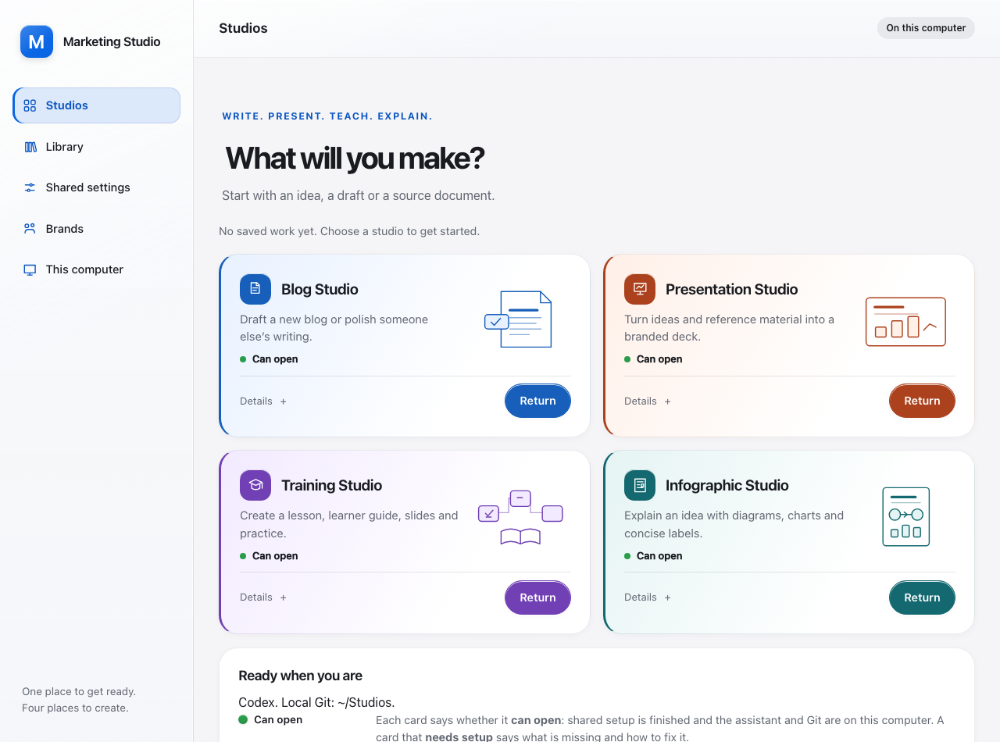
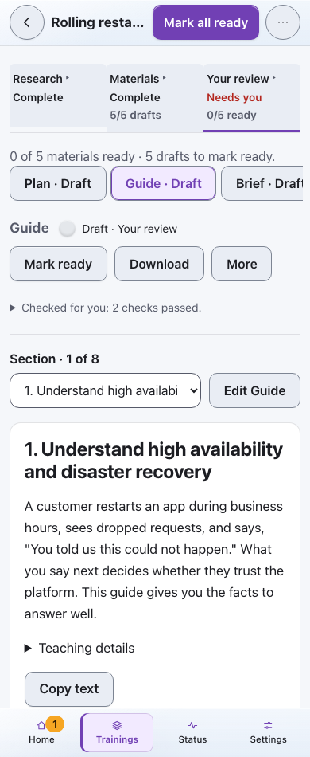
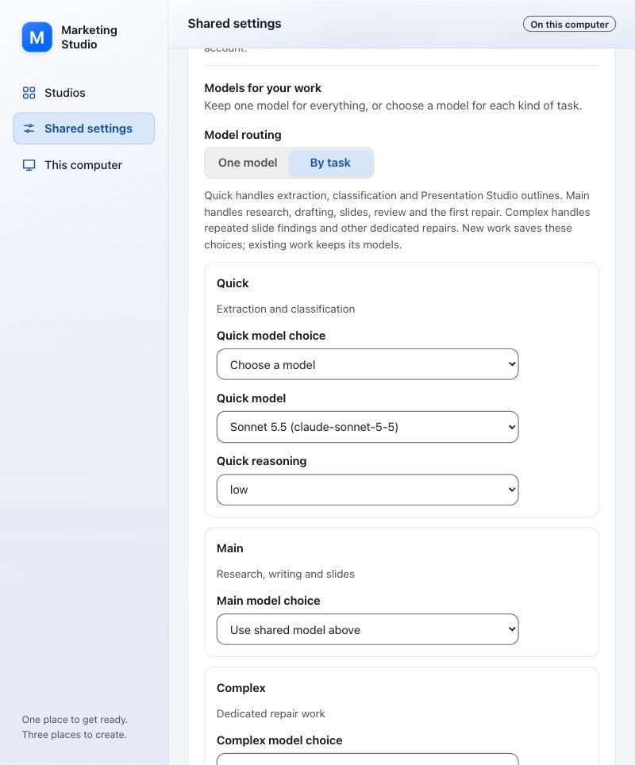
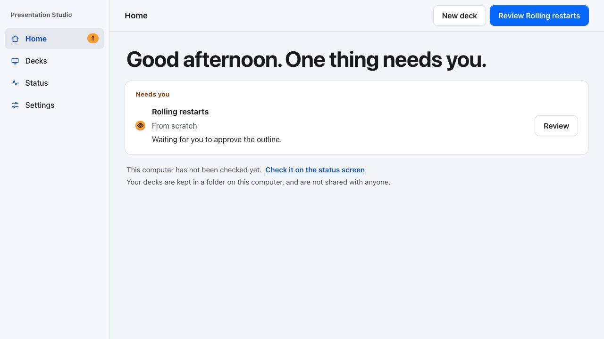

# Golden Gate-inspired studio UIs

Marketing Studio, shared setup, Blog Studio, Presentation Studio, Training Studio
and Infographic Studio use one restrained visual language through `ui-kit/style.css`. Use the
`macos-golden-gate-design` skill when available and keep the existing web stack.
This is a CSS approximation, not native system material or physical refraction.
Navigation and toolbar material use diffuse blur, a soft light edge and a subtle
cool tint. These highlights belong to the shell; the canvas stays neutral.

Marketing Studio uses blue for selected navigation and the system accent, when
available, for shared actions. Blog Studio uses
blue, Presentation Studio uses warm orange, Training Studio uses violet and Infographic Studio uses teal on
launch icons and buttons. The same identity follows into each native studio's
sidebar symbol, navigation, primary actions and selected controls through its
`data-product` attribute and the linked shared stylesheet. Each identity has
independent light and dark tokens.
Status words and dots retain semantic colors, and studio identity never replaces
the visible product name. Selection has a stronger label, bounded fill and accent edge.

| Surface | Treatment |
| --- | --- |
| Sidebar and unified toolbar | Subordinate neutral material, modest diffusion, shared pane boundaries |
| Forms, documents, reviews and data | Opaque content/paper tokens, readable text and quiet separators |
| Selected navigation or choices | Explicit selected state, accent and tighter rounded highlight |
| Studio launch cards and slide choices | Meaningful object boundaries, opaque fill, restrained border |
| Sheets, menus and toasts | One elevated surface with existing keyboard/dismissal behavior |
| Status and errors | Existing words and state shapes; semantic colors remain informative |

The shell meets the viewport edges. Ordinary content does not float inside an
extra rounded app window. Avoid per-row glass, wallpaper washes, repeated shadows
and pointer-following highlights. Keep material tokens separate from opaque
content tokens. Preserve current brand identity and use the existing system font
stack without distributing fonts.

Secondary actions use opaque neutral control fills and visible boundaries, including
on reading cards. Quiet means subordinate to the primary action, not transparent
or indistinguishable from the background. Disabled controls retain their shape
and reduced emphasis.

Shared tokens define independent light and dark appearances. Existing contrast
checks cover text, selected states, focus rings and semantic status colors.
Reduced transparency and increased contrast use solid surfaces and stronger
boundaries; reduced motion disables movement. When backdrop filtering is absent,
the opaque fallback retains the same layout and controls.

The native bottom navigation remains available at narrow widths. Shared setup
reflows field grids and keeps controls consistently sized. Long paths must wrap
within the pane rather than widening the viewport. Keep existing workflow,
authentication, source permissions and approval behavior unchanged in visual work.

The unified-settings HTML file in this directory is a design preview using
synthetic in-memory data. It shares this visual direction; its profile routing,
global limits and override interactions do not imply those pending backend
features are already implemented.

## Layout rules

These rules put each screen in the order a person works. Every studio follows them.

| Part | Rule |
| --- | --- |
| Toolbar | The screen's title (and Back only on a screen reached from another screen, never on a sidebar screen), then at most one filled primary action, then quiet secondary actions. A screen-specific action that is not the primary and has a long name goes under the lede instead. |
| Page header | One sentence in `.lede` saying what the screen is for, then any view-specific secondary actions in a `.bar` beside it. No buttons in a page heading block otherwise. |
| Order | What needs the person first, then work in progress, then ways to start something new, then setup, then finished or archived work. A form runs in the order it is filled; its submit sits at its end. |
| Filters | One row: search first and widest, then choice filters of equal share, then a plain Search button. Rarely used filters go under a **More filters** disclosure. On a phone only search shows, with a **Filters** button that opens the rest and counts those set. Filters apply on change. |
| Selection | A "Select all on this page" check sits on the list heading. A selection bar appears only while something is ticked: the count and how many are out of view, Select all on this page, Select all N matching (through the server, with the same filters), Clear, then the actions with the main one filled. It uses the toolbar material (`.glass`), stays in view below the toolbar on a desktop and sits above the tab bar on a phone. Ticks survive paging and filter changes; say so. |
| Lists | Objects a person opens are opaque cards (`.card`, `.grid`); records compared by columns are a quiet `.table` with one action per row, which becomes a card per row on a phone with its title and action unlabelled. |
| Sheets | Center creation sheets over a dimmed backdrop. Keep forms opaque with consistent rounded edges. Creation uses numbered pages with one current step, Back/Next, and a final Start. The footer stays outside the scrolling form body with one filled action, Save and close, and explicit confirmed discard. Nested sources return focus to their opener with choices kept. |
| Spacing | Cards and sections `1.1rem` apart; a step or field group `0.6rem` inside; one heading level per card (`.card-title`), `.sheet-part` for a section inside a sheet. |
| Long forms and editors | Use named sections or task tabs when a person works on one part at a time. Retain local edits, selection and focus across switches and refreshes. Reveal a hidden invalid field before focusing it. Keep status and the next action visible; put secondary explanations in disclosures. |
| Phone | Toolbar actions wrap under the title; long labels wrap inside their button; every control is at least 44px tall; fixed bars sit above the tab bar and the page leaves room for them. |
| Glass | Sidebar, toolbar, sheets, selection bars, Shared settings' save bar and toasts only. Forms, lists, documents and reviews stay opaque, and so does a `.dialog` that holds form fields. |

Golden Gate 2.1 favors integrated workspace structure and deliberate hierarchy.
The launchpad leads with the creative task, uses opaque studio-tinted cards and
filled launch actions, and keeps healthy setup explanations in Details. Needs you
and In progress remain visible; completed Recent work is a stable disclosure.
Empty, unavailable, limited and reconnecting saved-work states use different copy.

Training Studio's working
progress uses a shared separator instead of another content card. Current work,
usable drafts and actions stay visible; activity/timing and research approach are
disclosed separately. Creation keeps the next action and selected outputs
in its summary. Outline approval consequences and incomplete-scan warnings
stay visible. Disclosures need stable focus across refreshes and 44px touch targets.
Do not shrink text or hide meaningful uncertainty to achieve a shorter screen.

Healthy material headers share their title, state and actions without an extra
card around the document. Successful automatic checks are optional detail; problems
stay visible and creator approval stays explicit. More than three document sections
use a labeled native picker beside Edit, retaining focus, selection and local text.
At the phone breakpoint, commands reflow immediately instead of waiting for a poll.

The [November 2026 visibility review](2026-11-06-visibility-review.md) records the
cross-studio findings, fixes and desktop/phone verification.
The subsequent [Golden Gate 2.1 audit](2026-11-06-golden-gate-21-audit.md) records
the launchpad, reading-flow and responsiveness improvements with measurements.

## Golden Gate 3: the shell kit

One signature, kept to one place: the **progress track**, a project's stages as a single
line in its studio's colour, filled where done, larger where the work is now, and amber
where it waits for the person. Around it the shell stays quiet. `StudioShell`
(`studio_core/deck_web/shell.js`) gives every page the track, Search and jump (Cmd or
Ctrl+K), the Light, Dark and Auto appearance (one shared setting), and the finish card.
The Home headline is the one place the shell uses the system serif. See the
[design](../superpowers/specs/2026-11-10-golden-gate-3-design.md).

| Need | Component |
| --- | --- |
| A project's stages | `.track`, `.track-stage[data-state]` (`done`, `current`, `yours`, `todo`, `skipped`), `.track-compact` in a list |
| Search and jump | `.shell-palette`, opened by `StudioShell.palette()`; a page adds commands with `StudioShell.commands` |
| Appearance | `.appearance-switch` in `.shell-foot`; never a second copy of a token |
| Work finished | `.finish-card`, from `StudioShell.finish` |
| A desk as a workbench | A page part says its zone in `data-zone`: `top`, `parts`, `work-top`, `work`, `rail` or `foot`. From 72rem the page is three columns, the work in the middle, and a part with no zone joins the rail. Narrower, parts follow one another |
| A rail as tall as its own parts | `.workbench-rail` and `.workbench-parts` gather a zone's parts into one. The work and its parts then share a row, `foot` parts follow directly under them, and the rail runs beside all of it (Training Studio) |
| The one arc | `StudioShell.arc({at, yours, finished})`: Brief, Plan, Make, Ship, the same four in every studio |
| A line of light | `.workbench-pulse`, from `StudioShell.pulse('working' \| 'yours' \| 'still')` |
| The one move | `.move-card`, from `StudioShell.move`: the question, what it sets going, one amber action; `calm` where nothing waits. It animates (`.move-card-new`) only when it is a different move, never when it is drawn again |
| A band instead of a rail | `.workbench-top` holding `.workbench-head`, where a desk already pairs its work with a side panel (Blog Studio, a deck's slides) |

### One arc, one workbench, one move

Every studio makes its work the same way, so every desk says it the same way. The arc has
four phases, **Brief, Plan, Make, Ship**; a studio's own steps sit one press below it. The
work itself is the middle of the screen from the first moment. Everything about the
assistant, and the one thing it may need from the person, is in the rail (or the band).
A screen still has one filled button: the move's own action is amber. **F** on a desk reads
the work alone.

- **Make lasts until nothing is left to read or decide.** Reviewing drafts is Make, with the
  note "yours to review". Ship is sending finished work: Training Studio once every material
  is ready, Blog Studio in Finishing.
- **A studio with one status surface keeps it.** Infographic Studio's **Where this stands**
  already holds its route, **Needs you** and its revisions, and no control there shows more
  than twice. It takes the line of light and an amber edge on that card, not a second arc or
  move.
- **Work under way is never amber.** Amber means the person's move. While the assistant
  works, the card in the move's place is `StudioShell.move({working: true, ...})`: the
  studio's colour, what is being done, and that nothing is asked. `.desk-working-note` is
  the studio's colour too.
- **A slow read says so at once.** Bringing in a Google Doc or a page opens a sheet naming
  the steps before the request is sent, and closes itself when the desk opens.
- **A state is not a filled button.** The story in use is a "Selected" tag, and Polish on
  Blog Studio's desk is a plain button beside the move.
- **On a phone** the sidebar is the bar of screens, so **Search and jump** and the
  appearance close each page under its content (`.shell-foot-page`).

## Shared components and page stylesheets

`ui-kit/style.css` holds every token, the shell and the controls used by Marketing Studio,
shared setup, Blog Studio, Presentation Studio, Training Studio and Infographic Studio:

| Need | Component |
| --- | --- |
| Shell | `.backdrop`, `.window`, `.sidebar.glass`, `.content`, `.toolbar-wrap`, `.toolbar.glass`, `.page` |
| Actions | `.button`, `.button-filled`, `.button-quiet`, `.button-danger`, `.button-round` |
| Fields | `.field`, `.field-label`, `.input`, `.field-hint`, `label.field`, `.input-typed` |
| Exclusive choices | `.segmented` with buttons or radio `label.seg-option`; five or six options wrap onto rows and fill the chosen one |
| Independent form choices | Native checkbox in `label.check`; use fieldset/legend for a group. A focus ring never substitutes for checked state. |
| Compact marks outside forms | `.chips`, `.chip`, when an explicit pressed state and label explain the mark; use an action button for work that runs immediately. |
| Object choices | `.pick-cards`, `.pick-card`, `.pick-title`, `.pick-says` |
| Steps | `.workflow-steps`, `.workflow-step` |
| Surfaces | `.card`, `.paper`, `.table`, `.callout` |
| Headings | `.large-title`, `.lede`, `.card-title`, `.sheet-part` |
| Status | `.state` with `.bead`, `.tag`, `.toasts`/`.toast`, `.notice` |
| Transient | `.sheet`, `.dialog`, `.menu` |
| Studio mark | `.studio-symbol`, the rounded tile that carries a studio's drawing in its accent colour |
| Studio identity | `[data-studio]` sets `--studio-color` and `--studio-wash`; `.card[data-studio]` takes that studio's colour for its accent, link, focus and hover border |
| Way back | `.suite-link`, the "Marketing Studio" sidebar item a studio shows when Marketing Studio opened it |
| Filters | `.filter-bar` (a `.search` field first), `.more-filters`, `.filters-toggle` |
| Selection | `.panel-heading` with `.select-page`, and `.selection-bar.glass` with `.selection-count` and `.selection-actions` |
| Step row | `ol.intake-progress.intake-guided` from `Drafting.Intake.steps` in `drafting.js`: each step of a start as a button with its name, a tick once complete and what was chosen in it. Every studio's start shows it, whether the shared `pages` draws the sheet or the studio draws its own page |
| Sheet steps | `.create-flow`, `.create-step` (each headed by a `.sheet-part`), `.create-foot`, and the sticky `.sheet-heading`, opaque and reaching the sheet's edges so nothing shows behind it |
| Page | `.stack` (its parts `1.1rem` apart), `.page-head` (the `.lede` and a `.bar` beside it) |
| Ticks | `label.check` with its checkbox; `.research-choices` and `.site-choices` for Research from |
| Desk | `.desk-*` from `drafting.js`: the reading column and aside, part cards, the selection bar, History and the Finishing panel |
| Assistant activity | `.activity-*` from `activity.js`: each running job's "Now:" line and its Show activity disclosure, and the Activity log card; drawn on the card or paper they sit in |

A page stylesheet (`home.css`, `blog.css`, `deck.css`, or an inline style on a static page)
lays out its own parts. It may size and place a shared control, but never draws one, never
styles bare controls or headings for the whole page, and takes every colour from a token.
`tests/test_ui_consistency.py` checks the stylesheets' selectors; a page class on a shared
element is outside what it can see.

The current launchpad and reading desk below use synthetic data. The remaining
settings and Presentation Studio images illustrate their established surfaces.

The [Cult-inspired workflow implementation](../superpowers/plans/2026-11-07-cult-ui-workflows.md)
records the Training Studio inspector, compact progress, guided steps and grouped
delivery controls. These adapt interaction patterns within the shared vanilla UI kit.

[Actual Cult component ports and provenance](cult-controls.md) cover the shared animated
controls and launcher card surfaces, including reduced-motion and fallback behavior.
