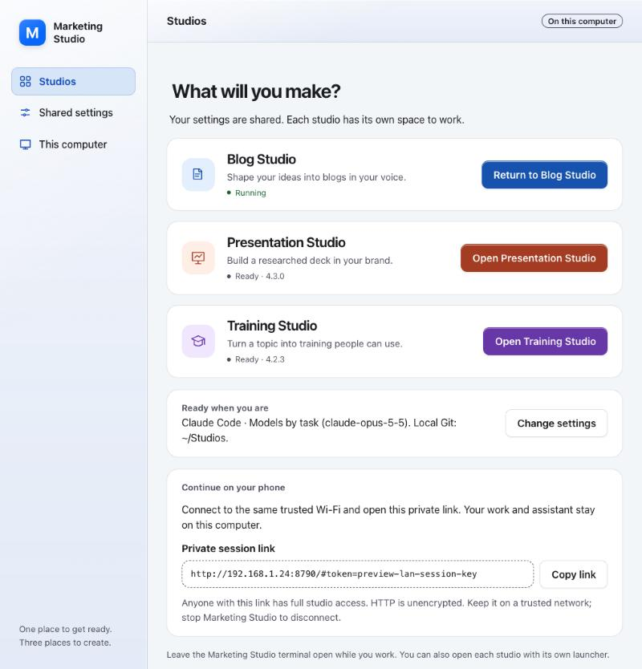
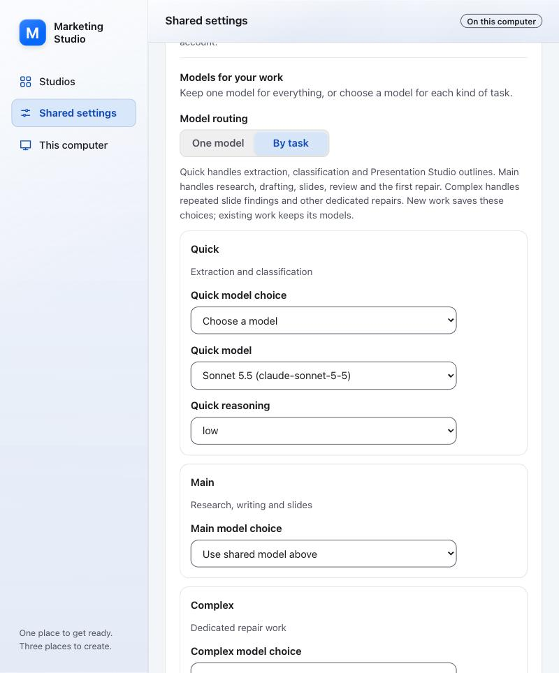
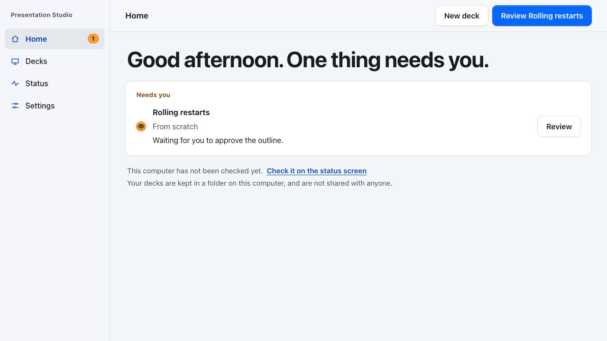

# Golden Gate-inspired studio UIs

Marketing Studio, shared setup, Blog Studio, Presentation Studio and Training
Studio and Infographic Studio use one restrained visual language through `ui-kit/style.css`. Use the
`macos-golden-gate-design` skill when available and keep the existing web stack.
This is a CSS approximation, not native system material or physical refraction.
Navigation and toolbar material use diffuse blur, a soft light edge and a subtle
cool tint. These highlights belong to the shell; the canvas stays neutral.

Marketing Studio uses blue for selected navigation and the system accent, when
available, for shared actions. Blog Studio uses
blue, Presentation Studio uses warm orange Training Studio uses violet and Infographic Studio uses teal on
launch icons and buttons. The same identity follows into each native studio's
sidebar symbol, navigation, primary actions and selected controls through its
`data-product` attribute and the linked shared stylesheet. Each identity has
independent light and dark tokens.
Status words and dots retain semantic colors, and studio identity never replaces
the visible product name. Selection has both a stronger label and a bounded fill.

| Surface | Treatment |
| --- | --- |
| Sidebar and unified toolbar | Subordinate neutral material, modest diffusion, shared pane boundaries |
| Forms, documents, reviews and data | Opaque content/paper tokens, readable text and quiet separators |
| Selected navigation or choices | Explicit selected state, accent and tighter rounded highlight |
| Studio launch cards and slide choices | Meaningful object boundaries, opaque fill, restrained border |
| Sheets, menus and toasts | One elevated surface with existing keyboard/dismissal behavior |
| Status and errors | Existing words and state shapes; semantic colors remain informative |

The shell meets the viewport edges. Ordinary content does not float inside an
extra rounded app window. Avoid per-row glass, wallpaper washes, repeated shadows
and pointer-following highlights. Keep material tokens separate from opaque
content tokens. Preserve current brand identity and use the existing system font
stack without distributing fonts.

Shared tokens define independent light and dark appearances. Existing contrast
checks cover text, selected states, focus rings and semantic status colors.
Reduced transparency and increased contrast use solid surfaces and stronger
boundaries; reduced motion disables movement. When backdrop filtering is absent,
the opaque fallback retains the same layout and controls.

The native bottom navigation remains available at narrow widths. Shared setup
reflows field grids and keeps controls consistently sized. Long paths must wrap
within the pane rather than widening the viewport. Keep existing workflow,
authentication, source permissions and approval behavior unchanged in visual work.

The unified-settings HTML file in this directory is a design preview using
synthetic in-memory data. It shares this visual direction; its profile routing,
global limits and override interactions do not imply those pending backend
features are already implemented.

## Layout rules

These rules put each screen in the order a person works. Every studio follows them.

| Part | Rule |
| --- | --- |
| Toolbar | The screen's title (and Back only on a screen reached from another screen, never on a sidebar screen), then at most one filled primary action, then quiet secondary actions. A screen-specific action that is not the primary and has a long name goes under the lede instead. |
| Page header | One sentence in `.lede` saying what the screen is for, then any view-specific secondary actions in a `.bar` beside it. No buttons in a page heading block otherwise. |
| Order | What needs the person first, then work in progress, then ways to start something new, then setup, then finished or archived work. A form runs in the order it is filled; its submit sits at its end. |
| Filters | One row: search first and widest, then choice filters of equal share, then a plain Search button. Rarely used filters go under a **More filters** disclosure. On a phone only search shows, with a **Filters** button that opens the rest and counts those set. Filters apply on change. |
| Selection | A "Select all on this page" check sits on the list heading. A selection bar appears only while something is ticked: the count and how many are out of view, Select all on this page, Select all N matching (through the server, with the same filters), Clear, then the actions with the main one filled. It uses the toolbar material (`.glass`), stays in view below the toolbar on a desktop and sits above the tab bar on a phone. Ticks survive paging and filter changes; say so. |
| Lists | Objects a person opens are opaque cards (`.card`, `.grid`); records compared by columns are a quiet `.table` with one action per row, which becomes a card per row on a phone with its title and action unlabelled. |
| Sheets | The only transient material. A sheet that makes something runs in numbered steps (`1. Name`, `2. Add`, `3. Choose`), each separated by a hairline, and ends with its submit and Cancel together. Sources that open their own sheet return to the step they came from with what they added. |
| Spacing | Cards and sections `1.1rem` apart; a step or field group `0.6rem` inside; one heading level per card (`.card-title`), `.sheet-part` for a section inside a sheet. |
| Phone | Toolbar actions wrap under the title; long labels wrap inside their button; every control is at least 44px tall; fixed bars sit above the tab bar and the page leaves room for them. |
| Glass | Sidebar, toolbar, sheets, selection bars, Shared settings' save bar and toasts only. Forms, lists, documents and reviews stay opaque. |

## Shared components and page stylesheets

`ui-kit/style.css` holds every token, the shell and the controls used by Marketing Studio,
shared setup, Blog Studio, Presentation Studio and Training Studio:

| Need | Component |
| --- | --- |
| Shell | `.backdrop`, `.window`, `.sidebar.glass`, `.content`, `.toolbar-wrap`, `.toolbar.glass`, `.page` |
| Actions | `.button`, `.button-filled`, `.button-quiet`, `.button-danger`, `.button-round` |
| Fields | `.field`, `.field-label`, `.input`, `.field-hint`, `label.field`, `.input-typed` |
| Exclusive choices | `.segmented` with buttons or radio `label.seg-option` |
| Independent form choices | Native checkbox in `label.check`; use fieldset/legend for a group. A focus ring never substitutes for checked state. |
| Compact marks outside forms | `.chips`, `.chip`, when an explicit pressed state and label explain the mark; use an action button for work that runs immediately. |
| Object choices | `.pick-cards`, `.pick-card`, `.pick-title`, `.pick-says` |
| Steps | `.workflow-steps`, `.workflow-step` |
| Surfaces | `.card`, `.paper`, `.table`, `.callout` |
| Headings | `.large-title`, `.lede`, `.card-title`, `.sheet-part` |
| Status | `.state` with `.bead`, `.tag`, `.toasts`/`.toast`, `.notice` |
| Transient | `.sheet`, `.dialog`, `.menu` |
| Studio mark | `.studio-symbol`, the rounded tile that carries a studio's drawing in its accent colour |
| Studio identity | `[data-studio]` sets `--studio-color` and `--studio-wash`; `.card[data-studio]` takes that studio's colour for its accent, link, focus and hover border |
| Way back | `.suite-link`, the "Marketing Studio" sidebar item a studio shows when Marketing Studio opened it |
| Filters | `.filter-bar` (a `.search` field first), `.more-filters`, `.filters-toggle` |
| Selection | `.panel-heading` with `.select-page`, and `.selection-bar.glass` with `.selection-count` and `.selection-actions` |
| Sheet steps | `.create-flow`, `.create-step` (each headed by a `.sheet-part`), `.create-foot`, and the sticky `.sheet-heading`, opaque and reaching the sheet's edges so nothing shows behind it |
| Page | `.stack` (its parts `1.1rem` apart), `.page-head` (the `.lede` and a `.bar` beside it) |
| Ticks | `label.check` with its checkbox; `.research-choices` and `.site-choices` for Research from |
| Desk | `.desk-*` from `drafting.js`: the reading column and aside, part cards, the selection bar, History and the Finishing panel |

A page stylesheet (`home.css`, `blog.css`, `deck.css`, or an inline style on a static page)
lays out its own parts. It may size and place a shared control, but never draws one, never
styles bare controls or headings for the whole page, and takes every colour from a token.
`tests/test_ui_consistency.py` checks the stylesheets' selectors; a page class on a shared
element is outside what it can see.

The screenshots below show the live pages with synthetic data.

