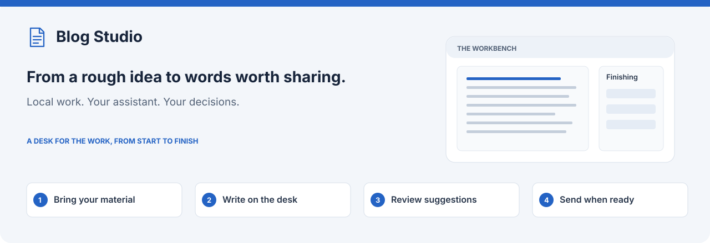

# Blog Studio

Turn ideas, notes and rough drafts into blogs that sound like you. Start a new
piece or bring an existing draft, including a Google Doc. Write with your signed-in
Codex or Claude Code assistant, then read, edit and finish on one writing desk.
Review any post, drafted or already published, for clarity to readers and AI search
with a GEO review or report.

Use Blog Studio independently or from [Marketing Studio](../../README.md). Google
Docs and team sharing are optional; you can write entirely in a local workspace.

[Install Blog Studio](#install-blog-studio) · [Start your first blog](#start-your-first-blog)
· [Get help](docs/troubleshooting.md)

## Install Blog Studio

Choose an available Blog Studio or suite bundle from
[Releases](https://github.com/dbbaskette/marketing-studio/releases), unzip it, and
run `bash install.sh` in the unpacked folder. No `.command` launcher is required.

Or install from source:

```sh
git clone https://github.com/dbbaskette/marketing-studio.git
cd marketing-studio
bash install.sh --studios blog
```

Choose assistant integration with `--target codex` or `--target claude`. Bring Git
and an installed, signed-in assistant. Prepared bundles include their selected
private runtimes and tools; source installers may fetch prerequisites. Existing
workspaces, settings and unrelated skills are preserved.

[Requirements and platform support](../../docs/installation.md) ·
[Independent bundles](../../docs/packaging.md)

## Start your first blog

1. **Open Blog Studio.** Use `marketing-studio open blog`, or launch it independently:

   ```sh
   sh ~/.local/share/blog-studio/studio
   ```

   Keep that terminal open while working. Complete shared setup once, then choose
   writing defaults and an optional brand in Settings.
2. **Choose your starting point.** **New blog** takes an idea, audience and point,
   or an outline and notes. Add sources on **Idea and sources**, then choose length,
   tone and an optional kind of post on **Writing preferences**. **Suggest three
   angles** uses the same sources. Supplied-source research and permission to search
   for additional sources are separate choices.
3. **Or choose Edit or polish a draft.** Paste writing, upload a file or read a
   Google Doc. Choose spelling and grammar suggestions, optional human-sounding
   wording or a voice guide, feedback, a reshape, or leave the draft unchanged.
   Research is not required just to copy edit.
4. **Read and refine.** The manuscript opens as a readable document. Go to a section
   or choose **Edit**; changes save as you type. A section note changes that section.
   Select words for Rephrase, Shorten, Expand, Fix or Ask. Whole-draft revision is a
   separate action. The Outline manages sections, and History compares and restores.
5. **Review changes, then send.** Suggestions are marked in the text with a reason
   and Accept/Reject. Accepting a suggestion preserves earlier text in History.
   Copy, download or choose a Google action yourself. Marking a blog as published
   records your decision; it does not publish to a website.

The start, drawn. Filled boxes are your decisions or input, tinted boxes are
assistant work and grey boxes are Blog Studio's own steps.

![Blog Studio start and write workflow: open Blog Studio, with shared setup the first time. New blog takes the idea and sources, then Writing preferences sets length, tone and an optional GEO review. The assistant researches only if you ticked research, then outlines and drafts with nothing needed from you, runs the GEO review only if you included it, and the draft opens on the desk for reading, Edit section or Full desk. Alternatively, Edit or polish a draft takes pasted text, an upload, a Google Doc or a link; What should happen first chooses the first pass, the assistant runs it (spelling, feedback, GEO or a reshape), then the GEO review if you included it, and the draft opens on the same desk.](docs/assets/blog-studio-workflow-write.svg)

## Finish without losing your voice

**Polish** opens Review mode for marked copy edits. A voice guide and Humanize can
add wording suggestions, while facts, quotations, code and structure remain
protected. You can accept individual changes, edit them, reject them or use the
available batch actions; a suggestion that needs your judgment stays for review.

Returning to a saved copy-edit review opens Review mode. Explicit Read, Edit section
and Full desk links keep that view, with **Review fixes** available after a restart.
For a linked Google Doc, **Review changes to send** previews local edits before
you choose **Send to Google Doc**. **Google Doc → Bring accepted changes** checks
incoming text separately; no incoming updates does not prevent sending local edits.

**Finishing** groups checks and proposals by purpose: Copy edit, Humanize, Quick
check, fact checking, headline/opening, feedback, voice, retrieval readiness (GEO)
and before-publishing tools. Quick check runs locally without an assistant.
Assistant-backed tools start only when requested; proposals wait for your decision.

**Voice guides** describe how writing should sound. Write one yourself or learn
one from samples, then apply it deliberately. Older author-profile tools remain
under Advanced. Sources used as writing examples supply style, not factual evidence.

Finishing and sending, drawn the same way:

![Blog Studio finish and send workflow: on the desk you edit, add notes or select a passage, and Revise the draft rewrites a section or the whole draft and returns. Finishing tools propose copy edits, fact checks and reader aids, and each proposal waits for Apply, Edit or Skip. The pre-publish check reports headings, links and evidence without an assistant, and Run GEO review says when the review is out of date. Send to Google Doc sends the changes as suggestions, after Make a Google Doc if the blog has none, or you copy or download the post; Bring accepted changes brings the owner's accepted text back onto the desk. Mark as published records where it went.](docs/assets/blog-studio-workflow-finish.svg)

Blogs started before the desk keep their older step-by-step run, which is not drawn here.

While the assistant works, each job shows what it is doing now as **Now: …**, and
**Show activity** lists everything it has done so far, newest first, with times. Each
blog's **Activity log**, on the desk and on a run, keeps every finished job, how it ended
and what it did. It stays on this computer and is never shared.

[Full desk and tool guide](docs/runner.md) · [Voice walkthrough](docs/new-user-guide.md)

## Make posts clear for AI search (GEO)

GEO, generative engine optimization, means making a post easy for AI search and
answer engines to read, quote and attribute accurately. Blog Studio treats it as
clarity for readers: the post's own text is the evidence, nothing is invented, and each
change is a proposal you preview, then apply or skip.

- **A GEO review of a draft.** **Include a GEO review**, off by default, is offered
  when you start a new blog and when you polish a draft. When it is on, one review
  runs once the full draft is written. You can combine it with **Check spelling and
  grammar** on a pasted, uploaded or Google Doc draft.

  To make GEO the first pass, choose **Review for AI search (GEO)**. It proposes:
  - direct answers;
  - consistent names;
  - claims with their dates, versions and conditions;
  - cited evidence;
  - passages that make sense on their own.

  A detail only you know, such as a date or a current product name, is asked for,
  never made up. **Run GEO review** sits beside the pre-publish check on every post,
  and says when a review is out of date because the post changed.
- **Reader aids, on request.** Finishing's **Reader aids and AI search** group adds:
  - an FAQ, with each answer taken only from the post and its sources;
  - key takeaways;
  - a comparison table;
  - word-for-word quotes from your sources;
  - image alt text;
  - a definition-style opening;
  - likely search questions, as advice only.

  Each addition is an aid for readers, not a way to earn citations or rankings.
  **Repurpose** writes an SEO meta description of up to 155 characters.
- **A GEO report for a published post.** **Get a GEO report for a published post**,
  on Home and in New blog, reviews a live post without bringing it onto the desk. The
  page is read once, without running anything on it, and shown before anything starts.
  The report shows:
  - what already works;
  - the changes ranked by how much they help, with no score;
  - the post with each change marked inline beside its reason, and additions shown
    where they would go;
  - the questions the post answers and the sources it needs;
  - **Page access**: noindex, a sign-in, robots.txt rules that block search crawlers
    such as Googlebot, OAI-SearchBot or PerplexityBot, structured data that disagrees
    with the page, and a missing byline or date.

  These are eligibility checks, never ranking promises. You can:
  - download the report as HTML (it prints to PDF) or Markdown;
  - make a new Google Doc with each change as a suggestion;
  - take the post to the desk;
  - choose **Run again** later to see what changed. Reports are listed in Blogs.

Some blogs send an empty page and fill it in with scripts, which Blog Studio never
runs. For those, **Ask Codex to find the post’s text** (or Claude Code, as chosen in
Settings) asks your assistant where the page gets its text:
1. The assistant gets the page's head and excerpts of the scripts it loads from that
   site, with no web access.
2. Blog Studio reads the address it names itself: https, the post's own site, and
   allowed by robots.txt.
3. If the fields it named turn out empty, the assistant gets one second look, at an
   outline of what that address returned.
4. The text is used only when it matches the page's title or description.

The address is remembered for that site on this computer, so the next post there
reads straight away.

The GEO report, drawn the same way:


[GEO review and reader aids](docs/runner.md#finishing) ·
[GEO report](docs/runner.md#geo-report-for-a-published-post)

## Google Docs, sources and libraries

A Google Doc is read through your computer’s existing Google sign-in; it need not
be made public. Review the captured text before proceeding. Missing or unreadable
images are not evidence that their content was read.

Imported text stays local until you explicitly choose a Google update, suggestions
or comments. After a copy-edit review of an imported Doc, only accepted changes
are sent as suggestions. Reconcile accepted Google edits through the supported
workflow instead of overwriting a locally changed draft.

**Link to a published post** brings a copy of a live post to the desk. The page is
read once, without running anything on it, and shown before anything starts. The
published page is never changed. A page built by scripts works as described in
[Make posts clear for AI search](#make-posts-clear-for-ai-search-geo).

The **team library** holds posts, examples and reusable material for a configured
team; without a Team Hub, that collection stays on this computer. The shared local
**Document Library** is separate: keep uploads for reuse across studios, or choose
**Only this blog**. A chosen library revision is copied into this blog. Taking a
newer revision is explicit and starts no research. Finished or published blogs can
be kept there as Markdown.

[Google Docs guide](docs/google-docs.md) ·
[Document Library](../../docs/shared-setup.md#the-document-library) ·
[Team workspaces](docs/team-workspace.md)

## Work in chat and return later

Start a new assistant conversation and ask it to use Blog Studio. In Codex you can
select `$blog-studio`; in Claude Code use `/blog-studio`. Ask for a complete blog,
an outline, proofreading or one specific edit. New chat work uses checked desk
records without starting another assistant process; expanding the request or
handing execution to the runner is explicit.

In the page, **Blogs → Continue editing** reopens saved work. In chat, ask for
**My blogs** or **Continue [title]**. The same saved blog and History are used in
both; ownership checks prevent a page worker and chat from editing over each other.

Older saved runs keep their compatible review flow. Eligible unfinished work can
move to the desk through a preview and explicit confirmation; missing-input or
unsupported work keeps its saved path. Migration grants no approval and starts no job.
Deleted blogs remain recoverable under **Recently deleted** for the stated retention period.

[Conversation desk](skills/blog-studio/references/conversation-desk.md) ·
[Saved-work compatibility](../../docs/saved-work-compatibility.md)

## Updates, help and development

Use **Status → Check this computer** for tools and assistant sign-in problems, or:

```sh
sh ~/.local/share/blog-studio/studio check
```

Failed steps explain retry and time-limit options while keeping saved work. Keep
private page links private. For an update, close idle studios and follow the
[installation guide](../../docs/installation.md); a source checkout can pull with
`git pull --ff-only` and reinstall its selected studio.

[Everyday requests](docs/prompt-cheat-sheet.md) · [Privacy](docs/privacy-review.md) ·
[Development](docs/development.md) · [What’s new](CHANGELOG.md)
