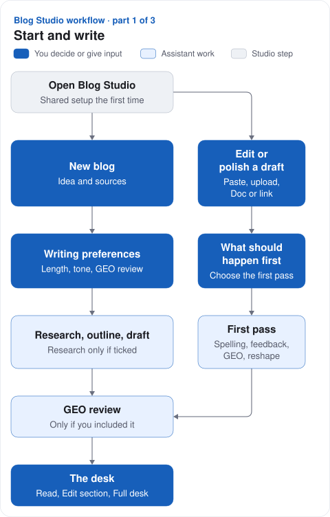
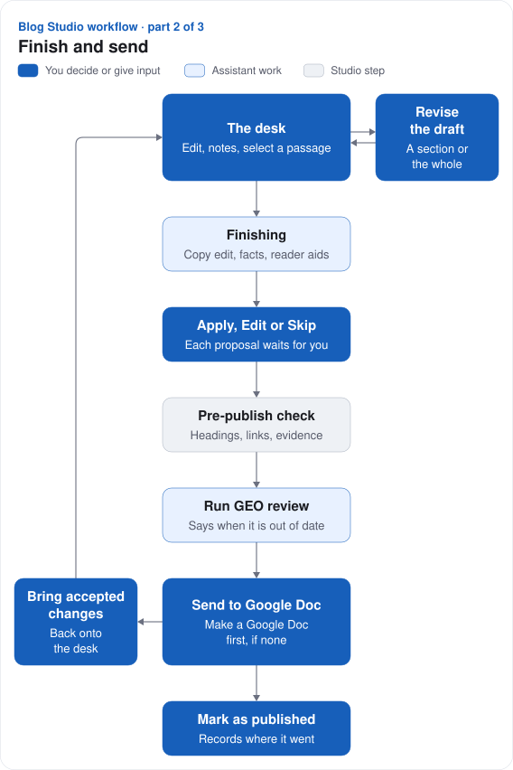
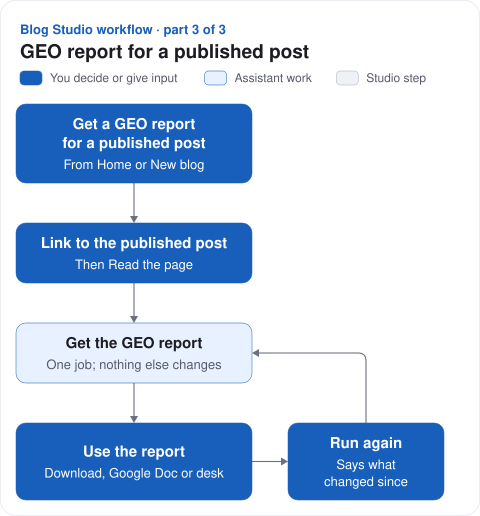

# Blog Studio

Write a post from notes, polish a draft, or review a published article. You can work in your own voice, see proposed edits in the manuscript, and choose which ones to keep.


## Open Blog Studio

From a Marketing Studio installation, this command opens the desk.

```sh
marketing-studio open blog
```

For a first install, download the suite or Blog Studio, unzip it, and run `bash install.sh` in the unpacked folder. Bring Git and a signed-in Codex or Claude Code assistant. For an independent installation, launch with `sh ~/.local/share/blog-studio/studio`. Keep the terminal open and choose your work folder on first launch. [Downloads](https://github.com/dbbaskette/marketing-studio/releases) · [Install from source](../../docs/installation.md#source-installers)

## Start your first blog

Suppose you have release notes and want to explain one change to customers. In **New blog**, a useful starting point is *“Write for people upgrading from the previous version. Use these release notes to explain what they’ll do differently the first day.”*

1. **Give the post a point.** Under **Idea and sources**, add your notes and name the reader. **Suggest three angles** can help if you’re still deciding which story to tell.
2. **Set the writing preferences.** Choose length and tone. Select research if you want it, and say whether the assistant may look beyond your sources. A voice guide can supply examples of how you write.
3. **Read the draft on the desk.** Edit the text yourself, select a passage to rephrase, or leave a note asking for a section rewrite. **History** lets you compare versions.
4. **Finish and share.** In **Finishing**, choose **Finish this post** for copy edits, wording suggestions and a claim check when sources are available. Accept or reject changes in context. Open **Share** to copy or download the result, or review the changes to send to a Google Doc. **Mark as published** records where you published it.

## Already have a draft or a live post?

| What you have | What to choose |
| --- | --- |
| A draft that needs polish | **Edit or polish a draft** accepts pasted text, an upload or a Google Doc. Pick the first pass, such as spelling and grammar, then review the marked passages. |
| A published article | **Get a GEO report for a published post** reviews how easily readers and AI search tools can extract and attribute its answers. Preview the captured text, run the report, then download it or take the post to the desk. |
| A saved Blog Studio project | Open **Blogs → Continue editing**, or ask your assistant to use Blog Studio and continue the post by title. |

<details>
<summary>See the writing, finishing and published-post workflows</summary>







</details>

[Voice and writing walkthrough](docs/new-user-guide.md) · [Google Docs](docs/google-docs.md) · [Work in chat](skills/blog-studio/references/conversation-desk.md) · [Troubleshooting](docs/troubleshooting.md) · [All studios](../../README.md)
