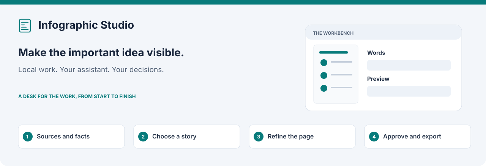

# Infographic Studio

Turn supplied information into one clear visual page. Bring documents, notes, links
or data; choose the story; refine the page’s words, charts and optional artwork;
then approve the exact checked version for export.

Download **PNG, one-page PDF, editable SVG and accessible text**. Labels and chart
marks remain editable in SVG; explanatory artwork stays raster. Infographic Studio
runs independently or from [Marketing Studio](../../README.md).

[Install](#install) · [Your first infographic](#your-first-infographic) ·
[Provider choices](#provider-choices-and-usage) · [Release status](#release-status)

## What you can make

Comparison, process, timeline, number callouts, component, measured parts-to-whole
and conceptual explanations. Choose A4, US Letter or a 1080 × 1350 digital portrait.
Numeric charts need actual comparable measurements and their context; a qualitative
comparison does not need invented numbers.

Captured sources and located facts support the story. A build does not silently
start public research, OCR or an image request. Assistant and image usage are
identified before their respective actions.

## Resume an unfinished form

New infographic saves your answers, step and captured-source acknowledgements privately. **Save and close** keeps the form across reloads; **Discard draft** removes only that form. Missing captures ask for replacement. Saving the form starts no assistant or image request.

## Preview recovery

A failed local preview keeps the saved composition and artwork. The recovery panel
names a safe category and next step: renderer unavailable, timeout, missing fonts,
invalid artwork/output, layout overflow or an unknown failure. Raw diagnostics stay
private. Home says **Preview failed** until a successful local retry; retrying a
preview starts no assistant or image request.

## Install

Choose an available Infographic Studio or suite bundle from
[Releases](https://github.com/dbbaskette/marketing-studio/releases), unpack it,
and run `bash install.sh` inside the folder. You do not need a `.command` launcher.

Or install from source:

```sh
git clone https://github.com/dbbaskette/marketing-studio.git
cd marketing-studio
bash install.sh --studios infographic
```

Bring Git and an installed, signed-in Codex or Claude Code assistant. The native
pipeline uses Python 3.11+ and its standard library. Rendering needs a compatible
headless Chromium renderer; prepared supported-platform bundles include their
private runtimes and pinned renderer. Node supports installed brand add-ons;
ordinary Infographic Studio work does not require Harness Research or Harness Slides.
Brand add-ons may have their own prerequisites. Nothing installs them automatically.

[Requirements and platforms](../../docs/installation.md) ·
[Packaging](../../docs/packaging.md) · [Renderer choices](docs/rendering-decision.md)

## Your first infographic

1. **Open Infographic Studio.** Use `marketing-studio open infographic`, or launch
   its independent installation:

   ```sh
   sh ~/.local/share/infographic-studio/studio
   ```

   Keep its terminal open. First launch uses the same shared setup as the other
   studios. Assistant, model, effort, brand and delivery defaults are shared;
   Infographic Studio keeps its own local workspace.
2. **Choose New infographic and Add information.** Paste text, upload text,
   Markdown, PDF, Word or HTML files, select CSV rows/columns, or read a Google Doc,
   Google Slides (read through Google Drive) or a public HTTPS page. Review captured
   text and extraction gaps.
   Picture-only PDFs need a readable text copy; Word intake means `.docx`.
3. **Save the brief and choose a story.** Set the audience, takeaway, must-show
   information and page size. Planning uses your captured evidence. Choose the
   story before building; unsupported or missing facts stay visible.
4. **Build and refine.** Inspect the page at its intended size. Edit words, revise a
   block, adjust the story or explicitly request artwork changes. History retains
   previous versions and downloads.
5. **Review and finish.** Record your review of the actual page; local checks run
   afterward. Optional assistant inspection is separate. **Approve revision N**
   approves that exact checked version and prepares its files locally. If rendering
   fails, **Prepare approved files** retries preparation without a new image request.
6. **Download or deliver.** Choose the local files or **Deliver approved page** for
   PDF, Google Doc or both. The receipt lists each selected output and partial
   failures honestly. A local PDF retry sends nothing to Google.

The story and build, drawn. Filled boxes are your decisions or input, tinted boxes
are assistant work and grey boxes are Infographic Studio's own steps.


## A visual editor with clear revision states

The preview stays beside **Edit words**. Select a named element, such as Page heading
or a step label, in the inspector or on the preview. Saving retains your selection
and explains when **Update preview** is needed. Current work, rendered preview and
last approved delivery are separate states.

History describes what changed and offers compare and restore. A restore creates
new work without approval; earlier approved files remain unchanged in **Saved files**.
Required wording, sources, calculations, readable fit and actual fonts are checked.
Missing or unlicensed fonts need your action; the repository does not redistribute
font binaries. Another computer needs compatible fonts to edit SVG accurately.

Long work stays attached to its infographic, so you can navigate elsewhere and
return to its progress. **Stop waiting** does not cancel the underlying work.
While your assistant works, its progress shows what it is doing now (**Now: …**), and
**Show activity** lists everything it has done so far, newest first, with times; research
shows the same for each research assistant. **Activity log**, on the infographic's screen,
keeps each finished assistant step and research job, how it ended and what it did, in
`projects/<id>/activity-log.jsonl` on this computer. It is never a revision and never
shared. Image generation and local steps add no lines.
Reloading or losing a connection does not automatically repeat an uncertain request.

Review to delivery, drawn the same way:

![Infographic Studio review, approve and prepare workflow: Edit words, where each save makes a new revision and Update preview shows it. Review page records what you inspected, then Record review and run checks runs the checks on this computer; Repair findings, when they fail, returns you to Review page. Approve revision N approves that checked revision only; a later change withdraws the approval and returns to Edit words. Prepare approved files makes the PNG, PDF, SVG and text on this computer, and Deliver approved page optionally sends a Google Doc, a PDF or both.](docs/assets/infographic-studio-workflow-approve.svg)

A page saved with the older text-paragraph layout first offers **Make this story visual**; that path is not drawn here.

## Provider choices and usage

| Configuration | Text, planning and inspection | Artwork |
| --- | --- | --- |
| **Codex** | Shared Codex model/effort and existing sign-in | Scoped built-in image route, when available to that installed runtime and account |
| **Claude Code + Gemini** | Your signed-in Claude Code assistant | An explicitly chosen image-capable Gemini model through its Interactions API |

Codex does not require a separate OpenAI image API key and does not silently fall
back to another provider. For Gemini, supply `GEMINI_API_KEY` in the environment of
the server you explicitly launch. A desktop launch does not inherit an arbitrary
terminal’s exports. Never put the key into shared settings, content, prompts or issues.
Gemini image API usage is separate from Claude Code usage.

Only reported usage/cost is shown; unknown prices are not estimated. Image intent
is recorded before a request. Uncertain results require recovery, not blind retry.
Cancel stops local adoption and owned CLI children; remote cancellation or charges
may remain unknown. Availability and real output quality require live acceptance.

[Provider capabilities and limits](docs/provider-capabilities.md)

## Sources, libraries and team work

- **Google reads** use existing gcloud sign-in and the exact preview you accepted.
  Import does not overwrite or share the source document. Visual-only source content
  is reported as a gap rather than treated as captured text.
- **Document Library** sources are checked copies of selected local revisions.
  Taking a newer revision is explicit and invalidates dependent work. Approved text
  and PDF can be kept in the shared local library, with a local retry if that fails.
- **Reviewed research** can be imported through a separately installed compatible
  Harness Research helper. Importing it is not permission to start public research.
- **Team repository** connects only when you choose it. Share a reviewed inventory:
  approved files/title by default; editable sources and artwork require separate
  selection. Private prompts and job records stay excluded. Failed pushes retain
  their commit and offer retry; synchronization does not discard conflicts.

Google delivery creates a new Doc containing the approved page image, editable
accessible text and source notes. The layout/artwork is raster there; SVG retains
editable labels/charts locally. Check the conversion in Google Docs. An interrupted
Google delivery offers read-only reconciliation instead of blindly creating another
Doc. Local PDF files remain usable when Google access fails.

[Document Library](../../docs/shared-setup.md#the-document-library)

## Work in chat and get help

Ask your assistant to use Infographic Studio with the supplied information and your
requested scope. Native commands use the same source, revision and approval checks
as the page. For a source checkout, `python3 runner/studio.py status` inspects the
studio and `python3 runner/studio.py serve --open` opens it; use Python 3.11+.
The installed launcher selects its supported interpreter for you.

[Conversation commands](docs/conversation.md) · [Saved contracts](docs/contracts.md) ·
[Acceptance](docs/acceptance.md)

Use the native **Settings** readiness information and `marketing-studio doctor` to
identify missing tools. Follow [installation and recovery](../../docs/installation.md)
for updates. Existing projects and approved exports remain in your workspace.

## Release status

The editing, rendering, provider-adapter and delivery features are implemented.
Offline fixture results do not prove live provider access or illustration quality.
Real Codex/Gemini generation, reference-guided editing, actual-image inspection and
owner artwork/accessibility acceptance remain first-release gates.

[Current release readiness](../../docs/infographic-first-release-readiness.md) ·
[Live provider, visual/owner acceptance and sign-off #224](https://github.com/dbbaskette/marketing-studio/issues/224) ·
[Concrete acceptance packet](../../docs/infographic-live-acceptance.md)

## Development

Use synthetic inputs, disposable settings/workspaces and injected providers:

```sh
python3 -m unittest discover -s tests -v
```

The tests do not download a renderer or start live providers. Real rendering checks
need an explicitly available renderer. There are no scripted browser journeys; see
[acceptance](docs/acceptance.md). A test pass is not live-provider or
owner artwork sign-off. [MIT licence](LICENSE)
