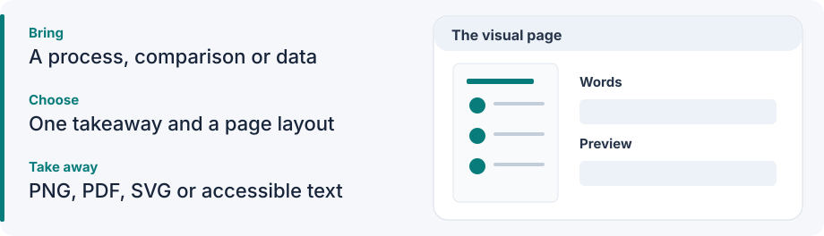
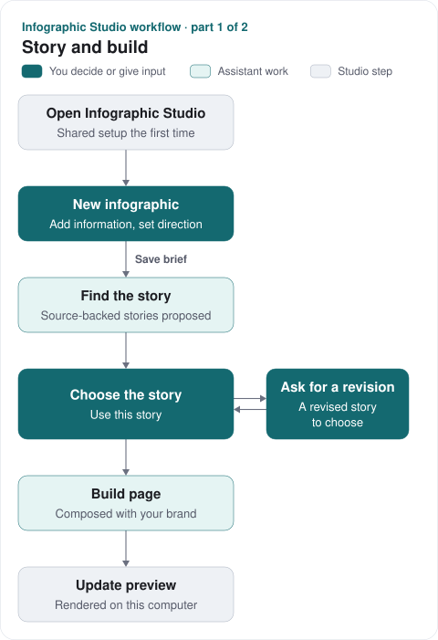
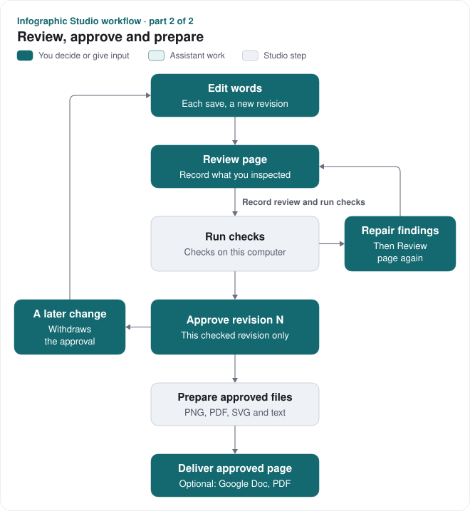

# Infographic Studio

Turn a process, comparison or set of measurements into one visual page. You choose the takeaway and the evidence, edit the words beside a preview, then download the approved page as PNG, PDF, editable SVG or accessible text.



## Open Infographic Studio

From a Marketing Studio installation, this command opens the desk.

```sh
marketing-studio open infographic
```

For a first install, download the suite or Infographic Studio, unzip it, and run `bash install.sh` in the unpacked folder. Bring Git and a signed-in Codex or Claude Code assistant. For an independent installation, launch with `sh ~/.local/share/infographic-studio/studio`. Keep the terminal open and choose your work folder. A supported platform bundle includes the renderer used for the local preview. [Downloads](https://github.com/dbbaskette/marketing-studio/releases) · [Installation](../../docs/installation.md) · [Renderer guide](docs/rendering-decision.md)

For a Training Studio job aid, choose **Import selected studio material**, select the Training Studio materials folder, then select **One-page job aid** for the approved blueprint. The preview carries the approved steps, evidence and exceptions. Choose A4 or Letter and keep the accessible text alongside the print version.

## Your first infographic

Suppose you have an onboarding checklist and need a handout. Try *“Show new partners the steps from invitation to first login. Use the order and role names in this checklist. Make it fit on one printed page.”*

1. **Capture the information.** Choose **New infographic → Add information**. Paste the checklist or upload it. You can also use CSV data, a public link, a Google Doc or Google Slides. Read the captured text before continuing.
2. **Pick the story.** Give the audience, takeaway and anything the page must show. Choose A4, US Letter or a digital portrait. **Find the story** proposes ways to use the evidence. Pick one with **Use this story**.
3. **Build the page.** Choose **Build page** and inspect the preview at its intended size. Use **Edit words** to fix a heading or label, then **Update preview**. For a chart, check that its values, units and comparison period match your source.
4. **Approve what you see.** Open **Review page**, record your review and run the local checks. Resolve any findings, then choose **Approve revision N** to prepare files for that version. If preparation is interrupted, **Prepare approved files** retries it.
5. **Choose a file or destination.** Download a file for local use, or choose **Deliver approved page** for the available PDF and Google Doc delivery options.

## Pick the right file

| Format | Use it for |
| --- | --- |
| **PNG** | A finished image for a website, post or slide |
| **One-page PDF** | Printing or sharing a fixed page |
| **SVG** | Editing labels and chart marks in a vector editor. Generated artwork stays raster. |
| **Accessible text** | Reading or reusing the page’s information as text |

Optional artwork uses the provider in **Shared settings → Document graphics**. Codex drawing depends on your account and installed runtime. Gemini drawing uses the configured picture model and bills to your Gemini API key. [Provider setup](docs/provider-capabilities.md) · [Live acceptance and release status](../../docs/infographic-first-release-readiness.md)

<details>
<summary>See how a story becomes a preview and approved files</summary>





</details>

[Work in chat](docs/conversation.md) · [Shared Document Library](../../docs/shared-setup.md#the-document-library) · [Preview and setup help](../../docs/installation.md) · [All studios](../../README.md)
