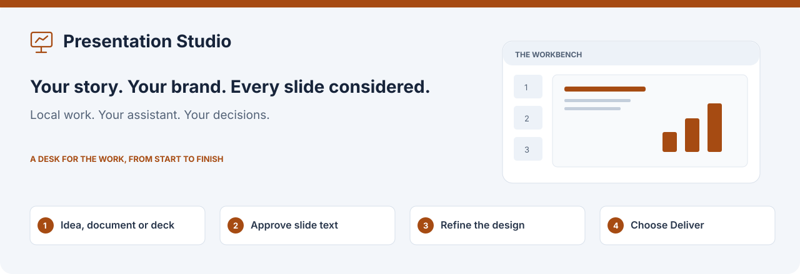
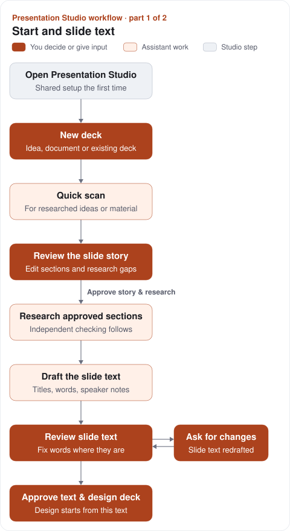

# Presentation Studio

Make an editable slide deck in your organisation’s brand, starting with an idea,
a document or an existing deck. Review the slide text before design, refine one
slide at a time, and decide when to deliver Google Slides or PowerPoint.

Presentation Studio works independently or from [Marketing Studio](../../README.md).
Your installed, signed-in Codex or Claude Code does the assistant work;
Harness Slides builds and checks the slides, and optional Harness Research handles
research. Your own brand skill supplies the visual identity.

[Install](#install) · [Your first deck](#your-first-deck) · [Runner guide](docs/runner.md)

Completed research section drafts can be read while the final check is pending and
survive a failed peer; retry unfinished work. Save a private queued note to revisit
in an explicit research change; it does not change an assistant's current work.
Source changes first show the affected scope, while wording and notes can stay
local. Final independent checks and exact-revision approval remain necessary.
See the [incremental workflow guide](../../docs/incremental-workflow.md).

## Install

Choose an available platform or Presentation Studio subset bundle from
[Releases](https://github.com/dbbaskette/marketing-studio/releases), unpack it,
and run `bash install.sh` inside that folder. A shell install does not require
opening a `.command` launcher.

Or install from source:

```sh
git clone https://github.com/dbbaskette/marketing-studio.git
cd marketing-studio
bash install.sh --studios presentation
```

Use `--target codex` or `--target claude` for the assistant integration. Prepared
bundles include their selected private runtimes and dependencies; source setup may
fetch prerequisites. Bring Git and your installed, signed-in assistant.

Deck production also needs your brand skill and its fonts, Harness Slides, and
preview tools. Local previews use LibreOffice and Poppler; Google previews and
delivery need the relevant Google tools and sign-in. Research needs Harness
Research. Missing prerequisites are shown before the work that needs them.

[Installation and supported platforms](../../docs/installation.md) ·
[Build a bundle](../../docs/packaging.md)

## Your first deck

1. **Open Presentation Studio.** Use `marketing-studio open presentation`, or its
   independent launcher:

   ```sh
   sh ~/.local/share/presentation-studio/studio
   ```

   Keep its terminal open while working. First-run shared setup asks for your
   assistant, work folder or team repository, name, brand and delivery preferences.
2. **Choose New deck.** The three steps are what you start from, audience and goal,
   and research and settings. Add references once, choose whether research may use
   outside sources, and choose a look pick or the brand’s default. The summary
   explains what will happen after Start.
3. **Approve the slide story before research.** With **Research the approved story**,
   one bounded Quick scan proposes sections, messages and research gaps. Edit, add or
   remove sections and questions; Save story starts no assistant. Approval starts
   targeted research and independent checking. The scan supplies no accepted evidence.
4. **Review the slide text.** For an idea, document or full rework, read titles,
   visible words, order and speaker notes, one slide at a time. Correct titles,
   points and notes directly; corrections and review position save privately across
   reloads. **Save corrections** starts no assistant or design work. Use **Ask for
   changes** for an assistant revision, or **Approve text & design deck** to approve
   all slide text with your corrections. Pick a look
   when you chose to pick one; genuine questions, failures and limits can also need you.
5. **Refine the designed deck.** The navigator shows every slide and what needs
   attention. Work on the selected slide, review findings, and use Finishing.
6. **Choose Deliver.** Confirm the output and any warnings yourself. Delivery
   creates the Google Slides link or PowerPoint result. Later changes produce a
   new delivery revision; the original source deck is never overwritten.

While the assistant works, each job shows what it is doing now as **Now: …**, and
**Show activity** lists everything it has done so far, newest first, with times. The
deck's **Activity log** keeps every finished job, how it ended and what it did. It stays
on this computer and is never shared.

The start, drawn. Filled boxes are your decisions or input, tinted boxes are
assistant work and grey boxes are Presentation Studio's own steps.



An existing deck at Brand only, Polish, Redesign, keep content or Selected changes
has no slide text to approve; its changes are made on a copy of the deck.

## Choose how much an existing deck may change

| Level | What may change |
| --- | --- |
| **Brand only** | Apply your brand while keeping the content |
| **Polish** | Improve layout and spacing while keeping the words |
| **Selected changes** | Patch the named slides in a copy |
| **Redesign, keep content** | Redesign while retaining the deck’s content |
| **Full rework** | Rebuild the story and slide text before design |

New deck supports PowerPoint and Google Slides input. A source document can be
Markdown, text, Word, PDF, a Google Doc or pasted text. Confirm whether it already
lays out slides or supplies material to build from.

## Work on the desk

Available tools depend on the existing-deck mode. Brand only and Polish keep slide
wording locked. Selected changes preserves speaker notes and does not offer earlier
slide restoration; it patches a copy of the original deck.

- **Words and speaker notes:** edit where you read them. Notes do not redraw slides.
  Words that cannot fit the existing drawing need your decision before a redraw.
- **Slide notes:** explain what should change. A redraw affects that slide’s section;
  the other sections stay as drawn. Its scope and available cost history appear first.
- **Outline:** reorder slides and change their content, with the redraw scope shown.
- **History:** compare earlier words and restore them. Drawings and previews are local
  to the computer that made them; teammates may have the words without those pictures.
- **Finishing:** review the brand check, deck findings, speaker-note proposals and
  timing. Apply or skip proposed changes yourself.
- **Sources:** add files, text or a Document Library revision without silently
  rerunning research. Research updates are separate, explicit actions.

Design to delivery, drawn the same way:

![Presentation Studio design, refine and deliver workflow: if you chose to pick a look, the brand draws one sample slide in each look; Pick the look, then Draw the deck in this look. The assistant designs the deck with Harness Slides in your brand. On the desk you change words and notes and use Finishing; Redraw slide N redraws that slide's section and returns. Deliver sends Google Slides or a PowerPoint file, and Delivered offers Open or Download revision N. A note or an edit after delivery makes the next revision on the desk.](docs/assets/presentation-studio-workflow-deck.svg)

Saved decks that keep their older step-by-step review are not drawn here.

After delivery, deck text and an available matching PDF can be kept in the shared
local Document Library. If the PDF cannot be kept, the page explains why rather than
claiming it was exported. [Document Library](../../docs/shared-setup.md#the-document-library)

## Work in chat

Ask your signed-in assistant to use Presentation Studio for the specific work you
want. New conversation work uses the same checked desk records; it is **not** a
new guided run. A text-only or outline-only request does not start design or another
assistant process. Ownership and scope are checked before saves or handoff to the
runner. Your approvals are separate from successful submissions.

[Conversation commands](skills/presentation-studio/references/desk.md)

## Teams and saved decks

Shared settings are common to all four studios; existing workspaces are not moved
when a default changes. Each team workspace has an independent clone. One computer
drives a deck at a time; takeovers and sharing are explicit, and private source or
preview files may need to be supplied on another computer.

Older decks retain their saved workflow and decisions. Eligible unfinished work
can move to the desk through **Open on the desk**, with preview and confirmation.
Migration starts no work and invents no approval. Unsupported or missing-input
work keeps its compatible path.

[Saved-work compatibility](../../docs/saved-work-compatibility.md) ·
[Migration details](skills/presentation-studio/references/migration.md)

## Help and development

Use **Status → Check this computer** for missing tools or sign-in. A failed step
keeps the saved work and explains retry options; a time limit needs your
explicit decision to continue. Nothing stops or warns for what a deck costs; where
the assistant reports a cost, it is shown as information. A team sharing failure keeps local work.

For updates and rollback, use the [suite installation guide](../../docs/installation.md).
Restart after updating when no assistant job is active.

[Runner and team workflow](docs/runner.md) · [Development](docs/development.md) ·
[Acceptance and limits](docs/acceptance.md) · [MIT licence](LICENSE)
