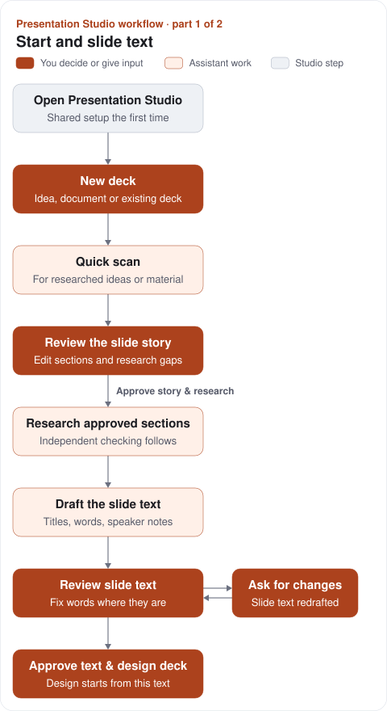
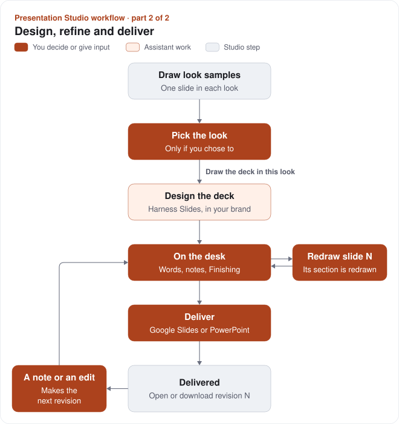

# Presentation Studio

Make an editable Google Slides or PowerPoint deck in your brand. Start with an idea, a document, or a deck that needs work. For a new deck, you can read exactly what each slide will say before it is drawn.


## Open Presentation Studio

From a Marketing Studio installation, this command opens the desk.

```sh
marketing-studio open presentation
```

For a first install, download the suite or Presentation Studio, unzip it, and run `bash install.sh` in the unpacked folder. Bring Git and a signed-in Codex or Claude Code assistant. For an independent installation, launch with `sh ~/.local/share/presentation-studio/studio`. Keep the terminal open and choose your work folder. Decks use Harness Slides, your brand and its fonts. Google delivery also requires Google sign-in. [Downloads](https://github.com/dbbaskette/marketing-studio/releases) · [Install and preview requirements](../../docs/installation.md)

## Your first deck

Try a brief with a decision in it. *“Use this pilot report to make a ten-minute presentation for the operations leads. They need to decide whether to extend the pilot. Keep the cost assumptions visible and put the calculation in the speaker notes.”*

1. **Choose New deck.** Add the report, name your audience and goal, and choose your brand and delivery format. If the document already spells out each slide, tell the studio it is a slide script.
2. **Set the research scope.** To investigate gaps, choose **Research the approved story**. Edit the proposed sections and questions before approving the research. You can also build from the material you supplied.
3. **Read the slide text.** A second pass checks the draft against your brief and sources. Review titles, points, order and notes. Make corrections or choose **Ask for changes**. **Approve text & design deck** starts design.
4. **Inspect and deliver.** Review the drawn slides and speaker notes. The studio checks the design and makes a pass of fixes. When the result is ready, choose **Deliver** to create the Google Slides link or PowerPoint file. You can return to the desk for another revision.

## Choose how much an existing deck may change

| Pick this option | When you want to… |
| --- | --- |
| **Brand only** | Apply your brand to the existing content |
| **Polish** | Improve layout and spacing while keeping the words |
| **Selected changes** | Patch specific slides in a copy |
| **Redesign, keep content** | Give the deck a new design around its existing material |
| **Full rework** | Reconsider the story and review new slide text before design |

An existing PowerPoint or Google Slides deck can be the starting point. Pick the smallest change that accomplishes your goal. **Selected changes** is a good fit for a request such as *“Update the chart on slide 4.”*

<details>
<summary>See the routes from source material through slide review and delivery</summary>





</details>

[Editing and team guide](docs/runner.md) · [Work in chat](skills/presentation-studio/references/desk.md) · [Setup and brands](../../docs/shared-setup.md) · [Help with missing tools](../../docs/installation.md) · [All studios](../../README.md)
