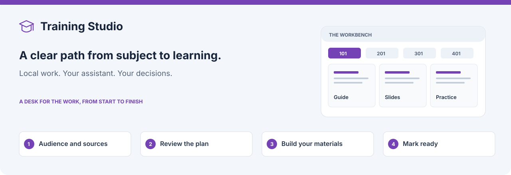

# Training Studio

Turn a subject into training people can use. Describe your learners and their goal,
review what will be taught, then build a learner guide, reference brief, slide deck
and practice at the levels you need. Read and refine the materials on one desk.

Training Studio works independently or from [Marketing Studio](../../README.md).
Your signed-in Codex or Claude Code does the assistant work, Harness Research
handles evidence, and Harness Slides builds requested decks in your brand.

[Install](#install) · [Your first training](#your-first-training) · [The desk](docs/the-desk.md)

Completed research section drafts can be read while the final check is pending and
survive a failed peer; retry unfinished work. Save a private queued note to revisit
in an explicit research change; it does not change an assistant's current work.
Source changes first show the affected scope, while wording and notes can stay
local. After the independent check, unresolved flags become your Include / Include with warning / Exclude
decisions; only requested warnings appear in the content. Your exact-revision material approval
remains necessary.
See the [incremental workflow guide](../../docs/incremental-workflow.md).

## Choose your materials

For practice and Yoodli, **Let AI choose** plans the scenarios for you. Choose
**Define scenarios** to add a short description of each situation instead. A
sentence or two is enough; AI fills in personas, dialogue, goals and evaluation
criteria for each selected level. You can change these descriptions in
**Change settings** while work is stopped. Existing materials wait for your update.

| Material | What it gives you |
| --- | --- |
| Research and teaching plan | Sources, learning objectives, coverage and sequence |
| Learner guide | The material learners read |
| Product or competitive brief | A concise reference for one subject or a comparison |
| Slide deck | Slides and speaker notes for teaching |
| Practice scenarios | Role-play, pitch, tutor or questionnaire practice |
| Optional Yoodli layout | Fields and reference material to build a roleplay in Yoodli yourself |

Choose levels **101** (introduction), **201** (practical use), **301** (architecture
and troubleshooting) and **401** (internals and advanced design). Research is shared;
each selected level gets its own materials. You can add levels later.

## Spending behavior

New work **warns and continues** when reported spending reaches its project amount.
Choose the default for each studio under **Shared settings → Spending**. Saved work
keeps its choice; open **Spending behavior** on its desk to explicitly change it.
Saving that choice starts no assistant job. Older saved tasks retain Stop and ask
and their existing Carry on action until you change the policy.

Warning-mode jobs receive a **$5 budget each**, with their existing time cap and
smaller Quick-scan budgets retained. A single job reaching its own budget still
stops for an explicit retry; completed peer work stays saved. Dollar enforcement
and reporting depend on the assistant. Unknown costs stay unknown. Hard-stop mode
retains the existing project allowance and remaining-budget reservations.

## Install

Choose an available Training Studio or suite bundle from
[Releases](https://github.com/dbbaskette/marketing-studio/releases), unpack it,
and run `bash install.sh` from that folder. You do not need a `.command` launcher.

Or install from source:

```sh
git clone https://github.com/dbbaskette/marketing-studio.git
cd marketing-studio
bash install.sh --studios training
```

Select integration with `--target codex` or `--target claude`. Bring Git and your
installed, signed-in assistant. Prepared bundles include selected private runtimes
and dependencies; source installers may fetch prerequisites.

Research requires Harness Research. Decks also require Harness Slides, your brand
skill and fonts, and the selected preview tools. Google and Word copies need their
optional tools. Missing capabilities are explained rather than silently substituted.

[Requirements and platforms](../../docs/installation.md) ·
[Package independently](../../docs/packaging.md)

## Your first training

1. **Open Training Studio.** Use `marketing-studio open training`, or its independent
   launcher:

   ```sh
   sh ~/.local/share/training-studio/studio
   ```

   Keep the terminal open. Complete shared setup with your assistant, work folder
   or team repository, name and optional brand/delivery choices.
2. **Choose New training.** Explain what learners should be able to do, their
   starting knowledge, the levels, time and materials. Add reference documents and
   choose where research may look: documents, approved sites and/or the public web.
3. **Review the training outline.** One bounded Quick scan proposes sections, objectives
   and research questions. Edit, add or remove them, then **Approve outline & research**
   starts research only for that scope. Accepted research and your approved outline
   guide the selected materials. Unresolved research flags become your decisions
   before you continue; warnings appear only where requested. There is no sample lesson
   to approve.
4. **Review requested slide text.** If you selected a deck, **Review slide text**
   opens the Deck tab with one slide at a time. Correct titles, points and notes
   directly; corrections and review position save privately across reloads. The
   Guide, Brief and Plan tabs stay available. **Save corrections** starts no
   assistant or design work. Use **Ask for changes** for an assistant revision, or
   **Approve text & design deck** to approve all slide text with your corrections.
5. **Read, edit and mark ready.** Material tabs show the formatted guide, brief,
   slides and practice; level tabs keep the depth separate. Review results as they
   arrive. **Mark ready** is your approval of the material shown, not merely evidence
   that the assistant finished writing it.

New trainings write each level's plan, guide and brief before moving to the next
level, then practice and Yoodli before decks. A slide approval therefore comes after
the selected readable materials. Older saved trainings keep their recorded order.
The [flow and task map](../../docs/design/create-training-task-flow.md) separates
the current sequence from proposed parallel work.

New authoring uses US English unless you request another language or variety.
Exact quotations, code, proper names and approved slide wording are preserved;
existing saved materials are not automatically rewritten.

While work runs, the desk names the current step, available drafts and next material.
The **Training workflow** map shows Outline, Research, Materials and Your review;
older runs show their saved sequence. Select a stage to see its detail. Materials
groups the selected readable drafts, practice and slides, with an **Open** action
for each saved draft. A slide approval stays on its own branch. Draft counts show
what exists now; ready counts show what you personally approved. There is no guessed
percentage or completion time.
Only an active material says **Writing**; others say **Queued** and explain their wait.
The latest activity stays visible. Expand **Activity** for individual jobs and
**Show activity** for their reported steps, newest first, with times. **Time so far**
shows elapsed time, not an estimate of what remains. The
**Activity log** at the foot of the training keeps every finished job, how it ended
(finished, failed, stopped, out of time or a limit) and what it did. It stays on this
computer and is never shared.

The plan, drawn. Filled boxes are your decisions or input, tinted boxes are
assistant work and grey boxes are Training Studio's own steps.


## Refine the training on the desk

Edit a part, add a note or select a passage for a focused change. History retains
previous versions. A result cannot silently replace text you changed while it ran.
Repeated Practice and Yoodli materials share a counted category tab, with an item
selector that names each scenario and its state. A single scenario keeps its own tab.

The selected material opens first; other editors load when you choose them, with
loading and retry feedback. Long documents use a **Section** picker beside **Edit**
to keep the reading area close. Section selection retains focus and local edits.
Healthy drafts have compact controls; expand **Checked for you** for automatic-check
details. **Mark ready** remains your review decision, and problems stay visible.

Rendered slides have three tasks: **Preview**, **Text & notes**, and **Review &
changes**. Selecting another slide keeps the review position and per-slide unsaved
text. On wide screens, the preview stays beside a focused inspector while editing
or reviewing suggestions. Narrow screens show one task with **Back to preview**;
History stays beside the task controls. The selected task also survives background refreshes. **Deck actions**, below the slide,
holds whole-deck changes and alternate looks. The slide card supports words, speaker
notes and section-scoped redraw requests.
Drawing-bound word edits retain Harness Slides’ explicit design-answer requirement.

In **Review & changes**, select the suggestions you want or choose **Select all
fixes**, then **Apply selected fixes**. The selected count and redraw scope appear
before you start. The fixes are queued together for one section redraw and deck
check; selecting suggestions starts no work. Choices survive slide navigation,
refreshes and failed requests while the drawing is unchanged. **Dismiss selected**
starts no redraw. A queued fix still needs the drawing and check to finish.

When an input changes, dependent material may be **held**. Choose **Update** to
remake it from the current input, or **Keep as it is**. The proposed update says
what it reaches and its available price history. New sources wait for the explicit
research update; adding a document alone starts no research.

**Change settings**, beside Try again when a training stops and in the desk's toolbar
while nothing is working, opens the start form with the training's saved values: the
topic, audience, levels, brief, deck, time limit, sources, external search and research
questions. **Teaching**, **Materials** and **Research** show one section at a time,
keeping values as you move between them. The action footer stays outside the scrolling
form, and a field that needs attention opens its section. Review says what the change
does before saving. Research not yet accepted into a
finished report is discarded and planned again, with the time and money it took said
first; a finished report is kept unless you choose to research again. The training then
waits for **Continue**.

**Finishing** applies to the selected material and proposes checks or changes.
Choose Apply, Edit or Skip. Local checks and assistant-backed checks are identified;
serious blocking findings still prevent readiness. **Mark this level ready** previews
its materials before confirmation. Undo or Return to draft retains History and
previous library copies; editing a Ready material returns it to Draft.

Building and finishing, drawn the same way:

![Training Studio build and finish workflow: the assistant builds the guide, brief, practice and Yoodli layout. When a deck is chosen, Review slide text either goes to Ask for changes, which rewrites the slide text and returns, or Approve text & design deck, after which Harness Slides designs the deck in your brand. You refine on the desk with edits, notes and Finishing, settling material that Needs updating with Update or Keep as it is. Mark ready approves each material or a level; Return to draft, after an edit or Undo, brings it back to the desk. Once every material is ready the index is written, and you can share it if you choose: download, Google Doc or Publish.](docs/assets/training-studio-workflow-build.svg)

Saved trainings begun before the desk keep their older flow, which is not drawn here.

[The complete desk guide](docs/the-desk.md)

## Download, reuse and share

Download one material or a ZIP of a level/all levels as currently saved. A download
does not mark anything ready. Ready guides and briefs can be kept as Markdown in
the shared local Document Library; a failure offers a local retry. Training deck
PDFs are not currently kept there. **Add from library** captures a selected revision
as this training’s own source.

Google Docs for a guide or brief are optional. Sending and pulling changes use the
supported explicit actions and conflict handling. The index and publishing are
separate from individual material readiness. A Yoodli layout is copied into Yoodli
by you; Training Studio does not upload it.

[Document Library](../../docs/shared-setup.md#the-document-library) ·
[Google Docs](docs/google-docs.md) · [Scenarios and Yoodli](docs/scenarios-and-yoodli.md)

## Work in a conversation

Complete setup first, then ask your assistant to use Training Studio in the configured
workspace. Describe the finite scope: a teaching plan, guide, practice, or the full
selected training. Checked desk commands create, inspect and submit the material
without starting a nested assistant. A page visit or restart does not transfer that
work to the runner; handoff is an explicit request.

Only you approve and mark materials ready. The conversation-owned page offers its
supported reading, readiness and download actions; it does not expose every runner
editing tool. Follow the [conversation guide](skills/training-studio/references/conversation.md).

## Teams, saved work and help

One computer drives a shared training at a time. Takeover is explicit; unshared
work and missing private inputs are handled before changes continue. Shared defaults
are common to all four studios, while each workspace stays where it was configured.
Older conversation work can share finished trainings, and reuse your team's
scenarios, audiences and research, through the [team hub](docs/team-hub.md).

Older saved trainings keep their compatible flow. Eligible unfinished work offers
**Open on the desk**, a read-only preview, then Apply/Cancel. It preserves original
records and starts no work or approval. Unsupported or missing-input work retains
its saved path. [Saved-work compatibility](../../docs/saved-work-compatibility.md)

Use **Status → Check this computer** for missing tools or assistant sign-in. Follow
the [installation guide](../../docs/installation.md) for updates and rollback; close
idle studios before an update. Never discard a workspace to fix a tool problem.

[Runner and team workflow](docs/runner.md) · [Development](docs/development.md) ·
[Acceptance and limits](docs/acceptance.md) · [MIT licence](LICENSE)
