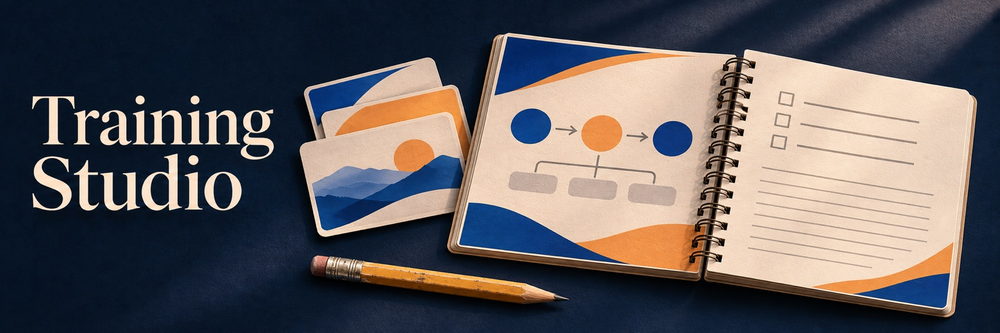
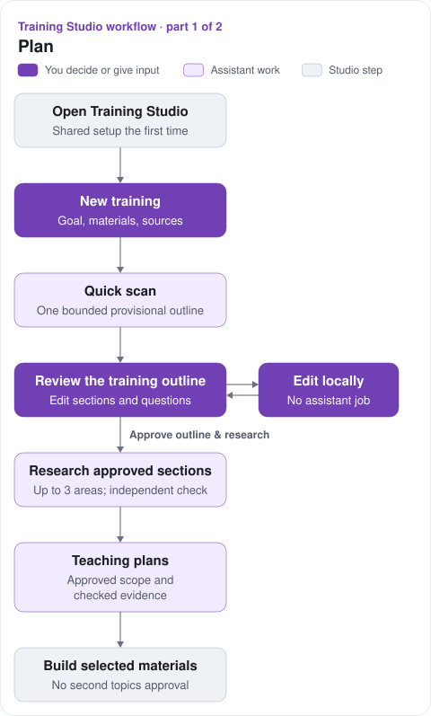
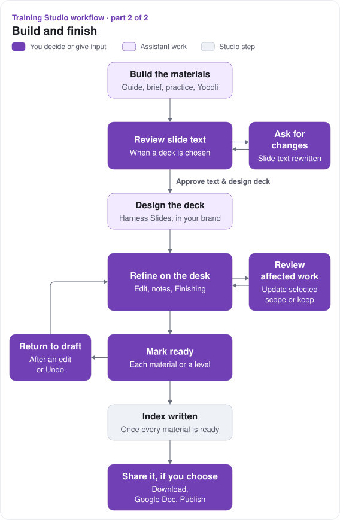

# Training Studio

Turn a topic and reference documents into a session people can teach or a workshop learners can practice in. Start by naming what learners should be able to do afterward. That goal guides the research, teaching plan and materials you choose.



## Open Training Studio

From a Marketing Studio installation, this command opens the desk.

```sh
marketing-studio open training
```

For a first install, download the suite or Training Studio, unzip it, and run `bash install.sh` in the unpacked folder. Bring Git and a signed-in Codex or Claude Code assistant. For an independent installation, launch with `sh ~/.local/share/training-studio/studio`. Keep the terminal open and choose your work folder. Training uses Harness Research. If you request a deck, you’ll also need Harness Slides and your brand. [Downloads](https://github.com/dbbaskette/marketing-studio/releases) · [Install and check requirements](../../docs/installation.md)

## Your first training

*“Teach new support engineers to decide when to escalate a ticket. They already know the ticketing system. Use the attached escalation policy and handoff template for a 25-minute workshop. Give them a worked ticket, then a different one to try. I need a learner guide and instructor slides.”*

1. **Describe the goal.** Choose **New training**. Name the audience, what they know, the task, and the time available. Paste an agenda or required objectives if you have them. Ask for a workshop when you want learners doing exercises during class.
2. **Add your documentation.** On **Sources**, add files, pasted text, links or a folder. Check what the studio could read. Choose whether research should use only that material or may also consult outside sources.
3. **Review the outline.** The first scan proposes sections, objectives and research questions. For the example above, look for both the escalation decision and the handoff. Edit the scope, then choose **Approve outline & research**.
4. **Review the materials as they arrive.** Plans, guides and briefs come first for the levels you chose, followed by selected practice and decks. With the default slide-text review enabled, edit the slides’ words and notes, then choose **Approve text & design deck**.
5. **Mark ready and export.** Review each finished item and choose **Mark ready**, or review a whole level together. **Export & share** offers individual downloads, a ZIP, and configured Google Doc actions.

## Choose your materials

| If the learner or instructor needs… | Select |
| --- | --- |
| A self-contained explanation with worked examples, questions and answers | **Learner guide** |
| A quick reference for a product or competitive comparison | **Reference brief** |
| Slides and speaker notes for a live session | **Slide deck** |
| A situation for rehearsing a conversation, pitch or decision | **Practice scenarios**. Describe your own situations or let the assistant propose them. |
| A roleplay to set up in Yoodli | **Yoodli**. The studio prepares the fields and reference material for you to enter. |

Use a single training for one audience. For a progression, choose **101** for an introduction, **201** for practical use, **301** for architecture and troubleshooting, or **401** for internals and advanced design. Selected levels share research and get their own materials.

For a repeatable task, the teaching plan can include a one-page job aid. Once you approve that plan, select its **One-page job aid** in Infographic Studio’s **Import selected studio material** picker. The review shows the evidence, learner task and success criteria for each objective.

## Refine the training on the desk

Open a saved guide, brief or slide to edit it. If a source changes, **Update** shows which materials need another pass. To build a second training for a different audience, **Copy as new** reopens the starting form with the prior choices and documents.

<details>
<summary>See the outline, research, material review and export steps</summary>





</details>

[Desk guide](docs/the-desk.md) · [Share training in a Team Hub](docs/team-hub.md) · [Practice and Yoodli](docs/scenarios-and-yoodli.md) · [Google Docs](docs/google-docs.md) · [Work in chat](skills/training-studio/references/conversation.md) · [All studios](../../README.md)
